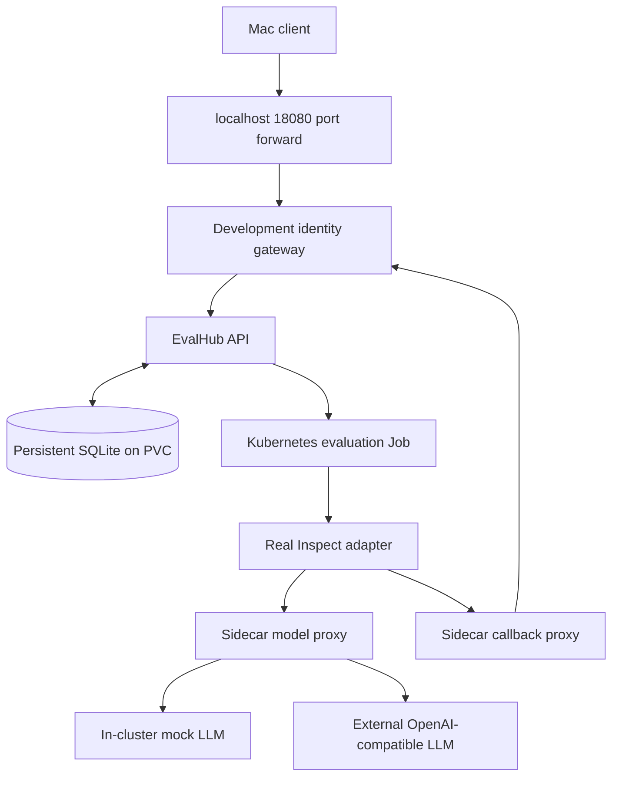

# EvalHub local kind testing environment plan

Date: 16 October 2026

Status: Implementation plan; the environment has not been deployed.

Run the EvalHub API, real evaluation framework, native sidecar, and Kubernetes Jobs on the existing local kind cluster. Use the same five-sample Inspect task in two modes: deterministic responses from an in-cluster OpenAI-compatible mock, or calls to a configurable external OpenAI-compatible LLM endpoint.

## Existing environment

Read-only checks on 16 October 2026 confirmed:

- Mac host and kind node architecture: ARM64.
- Kubernetes context: `kind-kind`; cluster name: `kind`.
- Kubernetes API endpoint: `https://127.0.0.1:60153`.
- One Ready control-plane node, running Kubernetes `v1.37.0`.
- Default StorageClass: `standard`, using the local-path provisioner.
- Only system deployments were present when inspected.
- Podman, kind, and kubectl are available locally.

Recheck these values before implementation, particularly if the cluster is recreated and its API port changes.

## Architecture



Observe API state, actual Kubernetes Job completion, model requests, and logs together. HTTP 202 from job creation is only acceptance of the request.

### Runtime choice

Run EvalHub without `--local`, so it uses the Kubernetes runtime. `--local` selects subprocess execution. Several provider local commands point to `tests/features/test_data/runtime/main.py`, which returns a fixed 0.7 score without calling an LLM. That stub cannot validate model traffic.

Keep the real Inspect adapter and sidecar running in both modes. Mock only the upstream model HTTP service.

## Model modes

### Mock mode

- Daily and CI default, with no paid credentials.
- In-cluster OpenAI-compatible HTTP endpoint.
- Five known prompt/answer fixtures and stable scoring.
- Request journal for assertions and failure injection.
- No external runtime dependencies after images and fixtures are prepared.

### External mode

- Explicitly selected OpenAI-compatible endpoint and model name.
- Real credential stored in a Kubernetes Secret and resolved by the sidecar.
- Same adapter image, task, scorer, callback path, and result handling as mock mode.
- Five prompts, concurrency one, bounded output tokens, retries, and deadlines.
- Assert infrastructure success and valid results; record quality scores and latency without requiring the mock's exact score.

### Illustrative evaluation requests

The local task, image, and fixtures below are planned additions. Validate request parameters against the pinned adapter before treating workload limits as enforced. Put the 64-token generation limit in the custom task's generation configuration.

Mock mode:

```json
{
  "name": "local-mock-smoke",
  "model": {
    "name": "local-mock",
    "url": "http://mock-llm.evalhub-local.svc.cluster.local:8000/v1"
  },
  "benchmarks": [
    {
      "id": "inspect/custom",
      "provider_id": "inspect",
      "parameters": {
        "task": "/app/tasks/local_smoke.py@local_smoke",
        "num_examples": 5
      }
    }
  ]
}
```

External mode:

```json
{
  "name": "local-external-smoke",
  "model": {
    "name": "<LLM_MODEL>",
    "url": "<LLM_BASE_URL>",
    "auth": {
      "secret_ref": "external-llm"
    }
  },
  "benchmarks": [
    {
      "id": "inspect/custom",
      "provider_id": "inspect",
      "parameters": {
        "task": "/app/tasks/local_smoke.py@local_smoke",
        "num_examples": 5
      }
    }
  ]
}
```

## Implementation sequence

### 1. Preflight and ARM64 images

All required containers start on the existing kind node.

1. Pin every operation to context kind-kind and cluster name kind. Verify its API endpoint remains https://127.0.0.1:60153; stop on a mismatch. Reuse this cluster and its standard StorageClass.
2. Use the existing Podman setup. Confirm which Podman connection owns the kind node and build/load images through that same engine. Prefer OCI image archives plus kind load image-archive, which avoids a local registry and Docker dependency.
3. Build the repository Containerfile for linux/arm64 with TARGETARCH=arm64 explicitly supplied. The resulting image already contains API, sidecar, init, and MCP binaries. Select each binary with its container command.
4. Build or verify an ARM64 Inspect adapter image from eval-hub-contrib; bake in the custom task and its five sample fixtures. Inspect is the first real framework; do not start with LM Harness tokenizers, large datasets, or GPU inference.
5. Build a small ARM64 mock HTTP service image. Use immutable development tags and image_pull_policy: IfNotPresent for the provider. Load all images into kind before deployment; do not assume published Quay images support ARM64.
6. Use Go 1.26.7 from this checkout's go.mod, uv for FVT dependencies, kubectl, kind, Podman, and jq. Start with a VM budget of 4–6 CPUs and 8–12 GiB RAM, one evaluation at a time; this is a sizing estimate to tune after measurement.

**Exit condition:** Node Ready; storage available; API, sidecar, init, adapter, and mock images load and execute without architecture or permission errors.

### 2. Deploy the core job environment

The API can launch Kubernetes Jobs and receive sidecar callbacks.

1. Create namespace evalhub-local, a one-replica EvalHub Deployment, namespace-scoped service account/RBAC, configuration/provider ConfigMaps, a Service, and a 1 GiB PVC. Use file-backed SQLite on the PVC for the first environment; preserve data over pod restarts.
2. Run /app/eval-hub --configdir=/app/config without --local. Mount an explicit config directory including provider definitions: the Containerfile does not copy config/. Use service.host=127.0.0.1 and service.port=8080 behind a small same-pod development gateway on port 8088.
3. Have the development gateway overwrite X-Tenant=evalhub-local and X-User=local-developer for both client requests and callbacks, forwarding to 127.0.0.1:8080. This is an explicit single-user trust fixture; authentication, RBAC authorization, and tenant isolation require the parity milestone below.
4. Leave EVALHUB_INSTANCE_NAME unset for this handcrafted profile. Set sidecar.eval_hub.base_url=http://evalhub.evalhub-local.svc.cluster.local:8088 and clear the OpenShift CA path. Otherwise the runtime constructs https://<instance>.<namespace>.svc.cluster.local:8443 and expects operator-created service CA resources.
5. Keep sidecar.local_mode=false and sidecar.base_url=http://localhost:8080. Set sidecar.sidecar_container.image and service.eval_init_image to the loaded combined EvalHub image. Generated job ConfigMaps must contain job.json and sidecar_config.json; the sidecar does not read an evalhub-config ConfigMap.
6. Grant EvalHub only the namespace permissions its runtime uses: Jobs, ConfigMaps, Secrets, Pods/logs, Events, and NetworkPolicies, including required reads, creates, owner-reference updates, lifecycle patches, and deletes. Derive exact verbs from helper call sites and check with kubectl auth can-i. Omit hardware profiles, queues, GPU, DRA, and their CRDs initially.
7. Retain the runtime's token isolation: adapter pod automount disabled, service-account token projected only into the sidecar. With instance name unset, job pods use the namespace default service account; it needs no broad Kubernetes permissions in this development profile.
8. Expose the API with a loopback-bound port-forward from localhost:18080 to Service port 8088 and metrics separately on 18081→8081. Both callback and mock URLs must use cluster DNS, never the Mac's 127.0.0.1.

**Exit condition:** Health and provider discovery succeed; generated job spec and sidecar config reference reachable endpoints; a real adapter callback updates stored state.

### 3. Deterministic mock mode — default

Repeatable end-to-end jobs make real HTTP model requests without external LLM calls.

1. Register a local Inspect provider override with the ARM64 adapter image and inspect/custom benchmark. Bake a simple Inspect task at /app/tasks/local_smoke.py@local_smoke: five fixed prompts, fixed expected answers, generate() with an explicit 64-token generation limit, and an exact-match scorer. No judge model, tools, dataset downloads, tokenizer downloads, or GPU.
2. Deploy mock-llm as an in-cluster ClusterIP Service on port 8000. Implement /health, GET /v1/models and POST /v1/chat/completions with the response fields used by the pinned client: id, object, created, model, choices, finish_reason and usage. Start with non-streaming; reject unsupported modes clearly and add streaming only if the adapter requires it.
3. Map known fixture prompts to stable responses; fail on unknown prompts. Store a request journal with correlation IDs and counts, excluding credentials. Provide reset and failure controls so each test starts from a known state.
4. Set model.url=http://mock-llm.evalhub-local.svc.cluster.local:8000/v1 and model.name=local-mock. The runtime rewrites adapter requests through the job's real sidecar model proxy. The mock can ignore Authorization; include a dummy Secret-backed credential case to verify sidecar reference substitution without real keys.
5. Submit via POST /api/v1/evaluations/jobs, poll GET /api/v1/evaluations/jobs/{id}, retrieve /{id}/logs, and correlate the API ID with generated Jobs, Pods, ConfigMaps, Secrets and lifecycle Events. Require both API terminal success and Kubernetes Job completion.
6. Assert five samples evaluated, exactly known score, expected mock requests, returned benchmark metrics and aggregate score, working logs, and sidecar termination. A second run should produce the same score; IDs, timestamps, and durations naturally vary.
7. After images are loaded, repeat with public internet unavailable to demonstrate no runtime dataset or LLM dependency. Do not claim NetworkPolicy egress isolation without verifying an enforcing CNI; plain kind networking may not enforce policies.

**Exit condition:** Three successive mock runs complete with the expected score, correct request journal, and no runtime external dependency.

### 4. External OpenAI-compatible mode

The same evaluation task completes against a configurable remote model.

1. Render the same job template with an external base URL, model name, and model.auth.secret_ref. Keep the adapter image, task, scorer, callback path, and result handling identical to mock mode. No global server mode switch is needed: the endpoint is a per-job setting.
2. Create a Kubernetes Secret in evalhub-local containing the supported api-key key from an ignored local credential file. The sidecar receives the real credential; the adapter receives the runtime-generated reference Secret. Never put a key into the request JSON, provider ConfigMap, evidence bundle, or committed configuration.
3. Gate this profile on LLM_BASE_URL, LLM_MODEL and a present credential Secret. Validate URL/path joining through the sidecar before the full test; /v1 must appear exactly once. Validate TLS using system trust or a configured CA when required.
4. Start with five prompts, concurrency one, bounded output tokens (for example 64 where supported), explicit HTTP deadlines, bounded client retries, and a ten-minute overall test deadline. Record request/token counts; use a provider-side spending limit when available rather than claiming a token setting guarantees a currency cap.
5. Check valid metrics, five evaluated samples, API completion, Kubernetes completion, logs, and evidence of real model traffic. Scores and latency are observational here; do not require the mock's exact score or a high benchmark score for infrastructure success.
6. Run external mode only when explicitly selected. Preserve the deterministic mock profile as the daily and CI default; require no paid credentials for it.

**Exit condition:** One real external evaluation completes through the sidecar with a Secret-backed credential, bounded workload, and usable stored results.

### 5. Regression, data staging, and optional outputs

A repeatable test command produces evidence and useful failures.

1. Add a targeted local-kind end-to-end suite with a unique run ID. Cover successful mock evaluation, invalid provider rejected before a Job is created, missing credential Secret, mock 401, transient and persistent 429, 500, timeout, malformed model response, multiple benchmarks, and hard-delete cleanup.
2. Distinguish retry expectations from guarantees: retries belong to the selected framework/client. Assert bounded attempts and a terminal outcome according to the pinned configuration, never indefinite pending/running states.
3. Reuse tests/kubernetes/features for resource shape and deletion coverage, setting SERVER_URL, KUBERNETES_NAMESPACE, AUTH_TOKEN and KUBECONFIG. This suite checks resource construction; it does not prove real LLM execution. The development gateway supplies the required X-User header; a dummy AUTH_TOKEN satisfies this profile's suite prerequisite only.
4. Run selected tests/features scenarios with an explicit GODOG_TAGS expression after checking dependencies. Default make test-fvt excludes cluster, local-runtime and benchmark-provider cases. Treat skipped scenarios as skipped, not passed, and avoid blindly running every @cluster case.
5. Add a separate data-staging scenario using a preseeded PVC and the existing tiny offline fixtures, then optionally Git/S3/HF-backed sources. Verify that an applicable source actually invokes /app/eval-runtime-init; a task baked into the adapter validates the core flow without exercising data init.
6. Offer an MLflow addon with local persistent storage, MLFLOW_TRACKING_URI and an experiment.name request. Assert benchmark metrics and run linkage. Offer an OCI-registry addon separately and assert exported artifact retrieval. Neither service should be a prerequisite for the first mock job.
7. Capture redacted request/response JSON, status history, adapter/sidecar/API logs, Job specs, Events, image IDs, Git SHA, and mode under bin/local-env/runs/<run-id>/. Preserve failure evidence before cleanup. Soft delete and hard delete should be tested according to their distinct API behavior.

**Exit condition:** One deterministic command passes the targeted suite, reports skips honestly, saves evidence, and removes per-run resources without deleting persistent environment data.

### 6. Operator and security parity

Broader coverage includes failures that cannot report results themselves.

1. Add a separate production-parity overlay using a pinned TrustyAI operator revision and its supported EvalHub CRD/schema. Check vanilla Kubernetes and ARM64 compatibility before installation; do not assume OpenShift Routes, service-serving certificates, OAuth, or OLM exist in kind.
2. Replace the development identity gateway with kube-rbac-proxy, real TokenReview/SAR/RBAC, tenant/job service accounts, and locally issued serving certificates and CA bundles. Maintain the expected HTTPS Service port 8443, EVALHUB_INSTANCE_NAME and service-CA naming contract. Use port-forwarding instead of an OpenShift Route.
3. Verify the operator job-failure reconciler, then test OOM, adapter crash before callback, ImagePullBackOff, missing PVC and unschedulable Jobs. Without this reconciler the handcrafted environment must not claim API convergence for these infrastructure failures.
4. Add tenant/owner authorization checks and cross-tenant denial cases. Verify generated NetworkPolicy behavior only after checking the cluster CNI enforces it; keep unsupported coverage clearly marked.
5. If the pinned operator requires unsupported platform APIs, record the compatibility gap and test its controller on a supported cluster or create an explicit local compatibility overlay. Never silently substitute a stub for the reconciler or mark parity complete.

**Exit condition:** Real authorization tests and infrastructure failures converge to the correct API state; supported-cluster limitations are documented.

## Proposed developer commands

These Make targets are deliverables to implement; they do not exist yet. Use one wrapper with explicit context and namespace arguments so setup, diagnostics, and teardown stay scoped.

```bash
make local-env-doctor
make local-env-build-load
make local-env-up MODE=mock
make local-env-test MODE=mock
make local-env-test MODE=external  # requires endpoint, model and Secret
make local-env-logs
make local-env-up MODE=mock ADDONS=mlflow
make local-env-test MODE=mock PROFILE=operator
make local-env-down               # preserve PVC/data
make local-env-reset              # explicit destructive reset of this environment only
```

Available now for inspection:

```bash
kubectl --context kind-kind get nodes -o wide
```

After deployment, expose the API:

```bash
kubectl --context kind-kind -n evalhub-local port-forward \
  --address=127.0.0.1 svc/evalhub 18080:8088
```

Then check `http://127.0.0.1:18080/api/v1/health`.

The acceptance runner should submit a job, save its ID, poll with a deadline, fail on unexpected terminal states, inspect the backing Job, assert results and model traffic, collect evidence, then clean up per-run resources.

## Coverage and completion checks

These are planned checks, not test results.

- **Mock happy path (Core):** Known score + five samples + model request journal + completed Job.
- **LLM failures (Core):** 401 / 429 / 500 / timeout / malformed output yield bounded terminal outcomes.
- **External happy path (External):** Valid results through sidecar with external endpoint and Secret.
- **Persistence and cleanup (Core):** Results survive API restart; hard delete removes job resources.
- **Init / MLflow / OCI (Addons):** Staged fixtures / linked metrics run / retrievable artifact.
- **Pod and scheduling failures (Operator):** OOM / image pull / crash / missing PVC become API failures.
- **Authorization and tenancy (Operator):** Proxy authentication, permitted owner access, cross-tenant denial.

## Files to add in the EvalHub repository

- `dev/local-env/base/` — Deployment, gateway, namespace RBAC, Services, PVC, explicit config/provider mounts.
- `dev/local-env/overlays/mock/` — Mock deployment, fixture settings, local image overrides.
- `dev/local-env/overlays/external/` — External endpoint settings and existing Secret references.
- `dev/local-env/overlays/operator/` — Pinned CRD/operator, proxy, certificates and service CA compatibility.
- `dev/local-env/addons/` — Optional MLflow, OCI registry and data-staging resources.
- `tests/local-env/{mock_llm,tasks,fixtures}/` — HTTP mock, Inspect task and tiny deterministic dataset.
- `scripts/local-env.sh + Make targets` — Preflight, build/load, deploy, submit/poll, test, logs and scoped cleanup.
- `tests/local-env/README.md` — Runbook, configuration reference, coverage boundaries and troubleshooting.

Run `make fmt lint` after implementation changes in the EvalHub repository, followed by the relevant targeted suites.

## Troubleshooting

- **Exec format error:** inspect image architecture and `TARGETARCH`.
- **ImagePullBackOff:** inspect loaded tags, provider pull policy, and Podman engine.
- **Pending PVC:** check StorageClass and first-consumer binding.
- **Missing ConfigMap or CA:** check that the manual profile did not enable `EVALHUB_INSTANCE_NAME`.
- **Callback 401 or missing identity:** inspect the gateway and both required identity headers.
- **Connection refused:** check cluster DNS versus Mac loopback and the sidecar upstream.
- **LLM 404:** inspect `/v1` path joining.
- **API stuck running while Pod failed:** check operator failure-reconciler coverage.
- **Empty metrics:** inspect adapter result schema and primary-score mapping.
- **Job never completes:** inspect adapter exit and native sidecar termination.

## Cleanup and persistence

Preserve shared cluster resources and run evidence. Use environment labels and explicit namespace ownership. Normal teardown should preserve the PVC and data; an explicit reset may remove only this environment's PVC and data. A local-path PVC survives pod restarts but is not a backup against deleting the kind cluster.

## Remaining implementation choices

- Exact external endpoint and model.
- Pinned compatible adapter and operator revisions.
- Whether MLflow and OCI exports belong in the daily workflow.

The core mock and external modes can proceed independently of these addons.

## References

Implementation details were checked against the local EvalHub checkout and the Inspect adapter in eval-hub-contrib. The pinned source revisions and API schema govern implementation; published guides provide supplementary context.

- [EvalHub source at a8fe402](https://github.com/opendatahub-io/eval-hub/tree/a8fe40207b431ccc8a71a12ace7aea106810bdb4), particularly `internal/eval_hub/runtimes/runtime.go`, `internal/eval_hub/runtimes/k8s/job_config.go`, `internal/eval_hub/runtimes/k8s/sidecar_config_json.go`, `config/providers/inspect.yaml`, `tests/features/test_data/runtime/main.py`, and `tests/kubernetes/README.md`.
- [EvalHub community adapters at 24e9272](https://github.com/eval-hub/eval-hub-contrib/tree/24e92727de1948355dcd4c5ba0752b97e6e3121f), particularly `adapters/inspect`.
- [kind image loading](https://kind.sigs.k8s.io/docs/user/quick-start/#loading-an-image-into-your-cluster).
- [Adapter and callback integration](https://eval-hub.github.io/guides/bring-your-own-framework/).
- [Lifecycle signals and operator failure handling](https://eval-hub.github.io/kubernetes/lifecycle-signals/).
