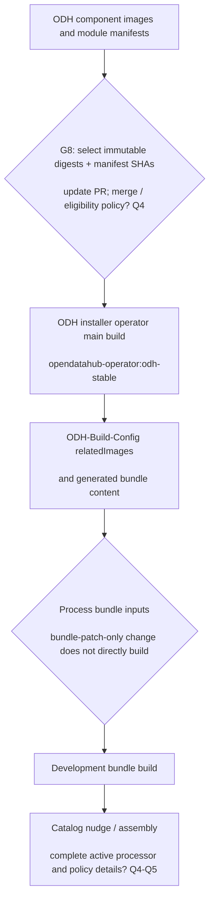
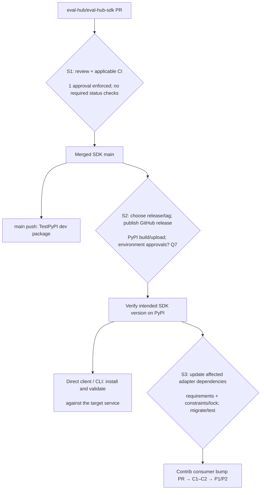
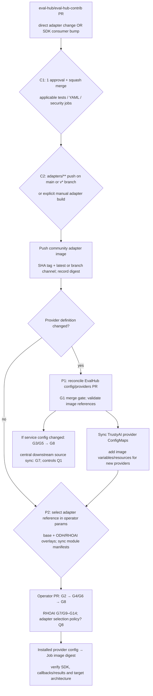

# From upstream PR to ODH images and a staged RHOAI installer

Research date: **19 October 2026**. Scope: **current ODH / next RHOAI
development builds**, through a **QE-installable staged catalog**. The inspected
RHOAI release-branch example is `rhoai-3.6`; EA branches have different freeze
controls.

This guide follows four entry points: service PRs, operator PRs, [SDK
updates](#4-sdk-update-path) and [contrib adapter
changes](#5-contrib-change-path). SDK and contrib changes have their own
package/build and consumer-selection gates before joining component promotion.

PRs in [eval-hub/eval-hub](https://github.com/eval-hub/eval-hub) and
[trustyai-explainability/trustyai-service-operator](https://github.com/trustyai-explainability/trustyai-service-operator)
pass through source synchronization, separate component builds, installer image
selection, bundle generation and catalog promotion. An upstream merge or an
image appearing in Quay does not establish that a staged installer contains it.

**Reading the diagrams:** diamonds represent gates or selection steps; dashed
arrows and `?` identify unverified handoffs or enforcement. A workflow
definition establishes configured behavior. EvalHub upstream required checks
were verified. SDK and contrib effective `main` rules require one approval but
list no required status checks; configured tests and operational verification
are distinguished from enforced merge rules below. No builds, merges or
promotions were triggered during this research.

- [Full SVG diagram](pr-to-installer/pr-to-installer.svg), with source links
  embedded in nodes.
- [Editable full Mermaid source](pr-to-installer/pr-to-installer.mmd).
- [Structured evidence](pr-to-installer/evidence.json), including commit-pinned
  source links, diagram nodes, gate descriptions and the observed EvalHub, SDK
  and contrib main branch rules.

## 1. Upstream PRs into ODH component images

The two component paths advance independently. Promotion PRs must merge before
their destination branch advances. TrustyAI produces both a workload operator
and a module operator.

```mermaid
flowchart TB
  subgraph eval["EvalHub source and ODH image"]
    EPR["eval-hub/eval-hub PR"]
    EG{"G1: required checks + review"}
    EPR --> EG
    EM["Upstream main"]
    EG --> EM
    ES{"G3: hourly :23 UTC sync PR<br/>
resolve conflicts + merge"}
    EM --> ES
    EODH["opendatahub-io/eval-hub main"]
    ES --> EODH
    EP{"G5: main to stable PR<br/>
resolve conflicts + merge"}
    EODH --> EP
    EST["stable push"]
    EP --> EST
    EB["Konflux build / scan tasks"]
    EST --> EB
    EI["quay.io/opendatahub/odh-eval-hub:odh-stable"]
    EB --> EI
    COMMUNITY["Parallel upstream CI output:<br/>
quay.io/evalhub/evalhub"]
    EM --> COMMUNITY
  end
  subgraph trustyai["TrustyAI source and ODH operator images"]
    TPR["trustyai-explainability/trustyai-service-operator PR"]
    TG{"G2: controller / module / Prow checks<br/>
required merge policy? Q2"}
    TPR --> TG
    TM["Upstream main"]
    TG --> TM
    TS{"G4: Pull bot sync PR<br/>
auto-approve / enable auto-merge<br/>
source config and cadence?"}
    TM --> TS
    TODH["opendatahub-io/trustyai-service-operator main"]
    TS --> TODH
    TP{"G6: main to incubation PR<br/>
then incubation to stable PR; merge each"}
    TODH --> TP
    TST["stable push"]
    TP --> TST
    TB["Konflux workload operator build"]
    TST --> TB
    TI["quay.io/opendatahub/trustyai-service-operator:odh-stable"]
    TB --> TI
    MOD["Separate module build on main<br/>
odh-trustyai-module-operator:odh-stable<br/>
branch compatibility? Q3"]
    TODH --> MOD
  end
```

EvalHub's [stable pipeline][odh-eval-build] and the TrustyAI [workload stable
pipeline][odh-workload-build] explicitly target `stable`. The TrustyAI [module
pipeline][odh-module-build] targets `main`; even its [copy on
stable][odh-module-stable] still names `main`. This is a concrete branch
difference to confirm, rather than an assumption that all images build from the
same branch.

The [central ODH build pipeline][odh-build-pipeline] defines scan tasks. Their
presence alone does not establish which findings prevent image selection or
merging. The parallel community image publisher is defined in [upstream
CI][eval-ci]; RHOAI performs its own downstream builds.

## 2. ODH image selection and installer context

The [daily 06:00 UTC / manual manifest updater][manifest-update] opens a PR to
update commit SHAs and resolve digests. Failed component fetches fail the
workflow and mark the PR `do-not-merge`. The [installer
configuration][manifest-pins] pins TrustyAI module manifests from ODH `main`,
and maintains explicit related-image digests. [ODH Build Config][odh-digests]
separately records selected image digests; atomic selection across these files
has not been established.

The [installer build][odh-installer] publishes `opendatahub-operator:odh-stable`
and nudges bundle inputs. [Bundle Sync CI][odh-bundle-sync] also generates
bundle content from installer `stable` every two hours or on manual dispatch.
The [bundle build trigger][odh-bundle] excludes bundle-patch-only pushes and
nudges catalog inputs after building. This ODH installer context is included to
explain how image availability differs from installer selection; the complete
live ODH catalog processor/policy chain was not audited.

## 3. Component source into Red Hat release builds and the staged installer

**The source flow is defined in central DevOps workflows**, outside the
component repositories. [Upstream to Downstream][rh-upstream-sync] runs every
four hours at minute 00 UTC and uses
[upstream-source-map.yaml][rh-upstream-map]:

- **EvalHub:** `opendatahub-io/eval-hub:main` →
  `red-hat-data-services/eval-hub:main`, with `automerge: yes`. This consumes
  ODH **main**, rather than ODH stable. A merged [manual sync PR
  #437][rh-eval-sync-pr] also corroborates these branches.
- **TrustyAI:** `trustyai-explainability/trustyai-service-operator:main` →
  `red-hat-data-services/trustyai-service-operator:main`, with **`automerge:
  no`**. The current scheduled selector excludes this entry; merged [PR
  #2036][rh-operator-sync-pr] shows a manual sync directly from upstream. Do not
  infer an ODH stable → Red Hat path for this component.

[Main to Release][rh-release-sync] runs every four hours at minute 30 UTC. Both
components are enabled in its [source map][rh-release-map], and
[releases.yaml][rh-sync-releases] currently selects `rhoai-3.6`. The [sync
action][rh-release-logic] resolves the source from the repository default when
no `src-branch` is provided; both defaults were observed as `main`. It merges
and **pushes directly** from Red Hat `main` into `rhoai-3.6`, rather than
creating a release PR. Conflicts outside excluded paths fail the action;
exclusions preserve destination-specific content. The [upstream sync
implementation][rh-upstream-logic] also merges/pushes directly for enabled
entries. These operations still depend on destination rules and bot permissions;
their effective bypass/enforcement policy remains Q1.

**Red Hat `main → stable` is a parallel path.** The central [Main to Stable PR
Creator][rh-stable-pr] runs daily at **00:30 UTC** or manually, uses
[main-stable-source-map.yaml][rh-stable-map], and opens component sync PRs plus
a GAP Leader PR. Merged bot PRs [EvalHub #438][rh-eval-stable-pr] and
[TrustyAI #2038][rh-operator-stable-pr] corroborate this handoff. It is not
configured as a prerequisite for `main → rhoai-3.6`. Source sync precedes
separate RHOAI builds; it does not copy ODH container images.

```mermaid
flowchart TB
  ODH["EvalHub: ODH main"]
  SYNC{"G7a: central upstream sync every 4h :00<br/>
EvalHub enabled; TrustyAI automatic entry disabled"}
  ODH --> SYNC
  UPSTREAM["TrustyAI: upstream main"]
  MANUAL["Manual sync PR; observed in merged history"]
  UPSTREAM --> MANUAL
  MAIN["Red Hat component main"]
  SYNC --> MAIN
  MANUAL --> MAIN
  RELEASESYNC{"G7b: central release sync every 4h :30<br/>
merge + direct push; preserve excluded files"}
  MAIN --> RELEASESYNC
  RELEASE["Red Hat rhoai-3.6 component branches"]
  RELEASESYNC --> RELEASE
  STABLEPR["Parallel: daily 00:30 UTC / manual<br/>
main → stable component PRs + GAP Leader PR"]
  MAIN --> STABLEPR
  MERGE{"G9: destination branch policy / conflict resolution<br/>
manual backports; freeze controls where applicable"}
  RELEASE --> MERGE
  COMPONENTS["Separate Konflux hermetic RHEL builds<br/>
EvalHub + workload operator + module operator<br/>
quay.io/rhoai/*-rhel9"]
  MERGE --> COMPONENTS
  NUDGE{"G10: component digest nudge PR<br/>
rhods-operator build/operator-nudging.yaml<br/>
bot + single-file + title/version feasibility"}
  COMPONENTS --> NUDGE
  ASSEMBLE["G11: Operator Processor<br/>
digests / operands map + image source metadata<br/>
prefetch manifests; commit processed content"]
  NUDGE --> ASSEMBLE
  OPERATOR["RHOAI installer operator build<br/>
quay.io/rhoai/odh-rhel9-operator"]
  ASSEMBLE --> OPERATOR
  BNUDGE{"G12: operator digest nudge PR<br/>
RHOAI-Build-Config bundle/bundle-patch.yaml<br/>
bot / file / title feasibility"}
  OPERATOR --> BNUDGE
  BPROCESS["Process CSV / relatedImages and Helm values<br/>
commit generated bundle / chart content"]
  BNUDGE --> BPROCESS
  BUNDLE["Bundle build<br/>
Helm chart builds are parallel outputs"]
  BPROCESS --> BUNDLE
  CNUDGE{"G13: catalog/catalog-patch.yaml nudge<br/>
PCC refresh + bundle snapshot selection"}
  BUNDLE --> CNUDGE
  CPROCESS["Process catalog content; commit"]
  CNUDGE --> CPROCESS
  FBC["FBC fragment build<br/>
live policy / EC / QE enforcement? Q5"]
  CPROCESS --> FBC
  STAGE{"G14: Push To Stage dispatch<br/>
signed-image presence + catalog/PCC validation<br/>
QE sign-off / caller / cadence? Q5-Q6"}
  FBC -.-> STAGE
  RESULT["Build and monitor staged catalog<br/>
QE installs via OLM"]
  STAGE -.-> RESULT
```

Both [EvalHub][rh-eval-build] and the TrustyAI [workload][rh-workload-build] and
[module][rh-module-build] release PipelineRuns build downstream source and
configure component digest nudges into the installer. The inspected pipelines
cover x86_64, ppc64le, s390x and arm64. Matching release branches resolve the
central pipeline from their release branch; scan definitions on central `main`
are not proof of the deployed release policy.

The [operator nudge workflow][operator-nudge] checks the bot, file count and
title/version pattern before invoking shared insta-merge logic. The [Operator
Processor][operator-process] and its [implementation][processor-logic] combine
nudged images with Build Config inputs, derive `git.url` / `git.commit` metadata
and prefetch manifests. The resulting [installer build][rh-installer] nudges the
bundle. A [nightly/manual refresh workflow][rh-nightly] also exists, but its
external caller and cadence were not established.

The [bundle nudge workflow][rh-bundle-nudge] handles eligible bot PRs. [Bundle
processing][rh-bundle-process] then generates content for the [bundle
build][rh-bundle-build]. The bundle nudges catalog input; [FBC
processing][rh-fbc-process] refreshes PCC and selects bundle snapshots before
the [FBC build][rh-fbc-build]. **The direct bundle and FBC build triggers
exclude patch-only pushes.** A nudge must pass through its processor and produce
qualifying content before that build occurs.

[Push To Stage][stage] is a `workflow_dispatch` workflow that accepts a chosen
FBC image or `LATEST_NIGHTLY`, checks signed-image presence,
validates/regenerates PCC, patches the stage catalog and monitors catalog
builds. A signature-presence check does not establish a full Enterprise Contract
verdict. The inspected [integration-test scenario][ec-scenario] still names
`rhoai-v2-17`, so it cannot prove the live `rhoai-v3-6` policy binding. Required
QE sign-off remains Q5-Q6.

## 4. SDK update path

A Python SDK release reaches direct client/CLI users through package
installation. Adapter-facing SDK changes must also pass the contrib path in
section 5; they do not automatically change the Go EvalHub service image.

1. **S1 — Review and CI.** Run the SDK unit matrix (Python 3.12/3.13/3.14),
   Ruff, mypy, pre-commit, commitlint and security checks relevant to the
   change. The observed [effective main rules][sdk-rules] enforce a PR and **one
   approval**, with no required status-check rule returned; classic protection
   returned 404. The [E2E job][sdk-tests] explicitly uses `continue-on-error:
   true`. Treat it as optional CI and arrange targeted service/sidecar
   integration validation for changed contracts. See
   [pre-commit][sdk-precommit], [commitlint][sdk-commitlint] and
   [Trivy][sdk-trivy] configuration.
2. **S2 — Publish a consumable version.** A merge to `main` triggers [TestPyPI
   publication][sdk-testpypi]. Production [PyPI publication][sdk-pypi] requires
   a **published GitHub release**, builds wheel/sdist from that release context
   and uses the `pypi` OIDC environment. Version is [SCM-derived][sdk-package];
   choose the tag containing the change and verify the uploaded version is
   installable from the intended index. The publish workflows do not depend on
   the Tests workflow. Environment reviewers and release/tag authorization
   remain **Q7**; TestPyPI publication alone does not complete this gate.
3. **S3 — Update each affected consumer.** For adapter changes, open contrib PRs
   to bump SDK requirements and regenerate constraints/lock files, adapt
   interfaces and verify compatibility with the target service/sidecar. Inspect
   illustrates why both files matter: [requirements][inspect-requirements]
   allows `eval-hub-sdk[adapter]~=1.0.5`, but [constraints][inspect-constraints]
   fixes `eval-hub-sdk==1.0.5`; its [Containerfile][inspect-container] applies
   both. Follow its [dependency regeneration
   instructions][inspect-dependencies]. The [Inspect unit
   workflow][contrib-inspect-tests] installs the SDK requirement without the
   image constraints, so a passing unit job alone does not prove which SDK the
   image contains.
4. **Continue through C1–C2 and P1/P2 below.** An SDK release does not trigger
   the contrib image publisher. Rebuild and select every affected adapter;
   reconcile provider definitions only when they change. For a direct
   client/CLI-only update, install the SDK and validate it against the deployed
   service; no adapter or installer update is inherently required. The [Go
   service Containerfile][eval-container] does not install this Python package.

**Completion evidence:** SDK merge SHA → published release/tag → package version
and index → consumer dependency commit → actual SDK version in the rebuilt
adapter image → selected adapter digest. An unreleased source checkout or a
successful TestPyPI upload is not evidence that production adapter users
received the change.

## 5. Contrib change path

Start here for adapter implementation, framework/dependency, Containerfile or
provider changes, including an SDK consumer bump from section 4. Adapter images
are separate dependencies of evaluation Jobs.

1. **C1 — Prepare, review and test the adapter PR.** Follow
   [CONTRIBUTING][contrib-contributing]: adapter code, Containerfile,
   requirements/constraints, `provider.yaml`, tests, README and Makefile targets
   as applicable. The observed [main rules][contrib-rules] require **one
   approval and squash merging**, with no required status-check rule returned;
   classic protection returned 404. Adapter tests are path-specific (for example
   [Inspect][contrib-inspect-tests]). [Commitlint][contrib-commitlint],
   [CodeQL][contrib-security] and [Trivy][contrib-trivy] are configured; Trivy
   has a HIGH/CRITICAL failure step. These jobs are not established as required
   merge checks. [Provider validation][contrib-validate] runs on `adapters/**`
   PRs into `main`, but its [script][contrib-validator] only checks **new
   adapter directories** for a present, parseable `provider.yaml`; it does not
   enforce the complete schema or validate existing adapters.
2. **C2 — Build and publish the affected images.** The
   [publisher][contrib-build] runs after `adapters/**` pushes to `main` or
   **`v*` branches**, or on manual dispatch. It detects adapters from the last
   commit, builds their Containerfiles and pushes
   `quay.io/evalhub/community-<adapter>:<commit-SHA>` plus `latest` on main or
   the branch name on release branches. A tag push is not this workflow's
   configured trigger. Root-only/workflow-only changes and a new SDK release do
   not automatically rebuild images; manually dispatch with the adapter name
   when needed. The [manual all-images workflow][contrib-build-all] uses an
   explicit matrix, so check coverage for new adapters. ToolEval also builds
   `toolbench-server`; `clear` publishes as `community-ibm-clear`. [RULER has an
   overlapping publisher][contrib-ruler] targeting the same tags (Q8). These
   publishers do not wait on test/security workflow results. Verify successful
   push, resolved digest, actual installed SDK/dependencies and target
   architecture; the configured Docker build has no explicit multi-platform
   matrix.
3. **P1 — Reconcile provider definitions if changed.** Contrib's
   [provider.yaml][inspect-contrib-provider] and EvalHub's [config/providers
   YAML][inspect-service-provider] are distinct files; the inspected publisher
   does not synchronize them. Open a service PR for changed benchmark
   metadata/runtime fields and pass **G1**. Its [image-existence
   check][provider-image-check] skips newly added providers on PRs, then checks
   them on matching main pushes; image existence alone does not prove
   compatibility. The [ConfigMap drift workflow][config-sync] runs after main
   pushes, nightly at **02:00 UTC** and manually, rather than on PRs. Its
   [comparison][config-sync-logic] skips Kustomize image variables, so drift
   success does not prove the selected image version.
4. **P2 — Select the image and update operator/module configuration.** In a
   TrustyAI PR, run [`hack/sync-evalhub-providers.sh
   <source-ref>`][provider-sync-script] when provider/collection definitions
   change and review the generated ConfigMaps. Follow the [operator sync
   guide][provider-sync-guide] for new providers: register image variables in
   [base kustomization][provider-image-vars], add [base][provider-base-images],
   [ODH][provider-odh-images] and [RHOAI][provider-rhoai-images] `params.env`
   entries, and update resources. For an image-only change, check/update the
   relevant existing selections without requiring an unrelated service config
   PR. Run [`hack/sync-trustyai-module-manifests.sh`][provider-module-sync]
   after config changes; it copies the config tree into
   `trustyai-operator-module/config/manifests-template`. Review both trees
   before merging through **G2**.
5. **Join the existing promotion paths.** Service config changes follow
   **G3/G5**; operator manifests/image selections follow **G4/G6** and installer
   selection **G8**. For RHOAI, confirm the matching release branch and pass
   **G7/G9–G14**; **G7** now defines the central source flow; **Q1** remains
   open only for enforcement and recovery. The observed image selection is
   concrete: base uses `community-inspect:latest`, whereas upstream ODH/RHOAI
   overlays and the [downstream `rhoai-3.6` overlay][rh-provider-images] select
   `community-inspect:v0.6.12`. A new `latest` build does not update that pinned
   channel. Either build the chosen release branch/channel or deliberately
   update the selected reference; record the immutable digest because
   branch/channel tags can move. The [downstream provider
   ConfigMap][rh-inspect-provider] substitutes
   `$(evalhub-provider-inspect-image)` and its overlay references the community
   image. A separate RHEL adapter rebuild/nudge, mirroring and release
   eligibility must be established rather than inferred (**Q8**).
6. **Verify the installed job.** Treat this as completion evidence for the
   change, not an already enforced CI requirement: inspect the rendered
   operator/module provider ConfigMap and resulting Kubernetes Job/Pod image
   digest; confirm the embedded SDK version, target architecture and
   service/sidecar callback/result compatibility with an actual evaluation.
   Provider ConfigMaps are [reconciled by the operator][rh-provider-reconcile].
   A successful API submission or a new image in Quay alone does not prove the
   adapter update reached stage.

**Completion evidence:** contrib merge/selected release commit → image digest
and embedded SDK version → provider config commit if changed → selected operator
overlay reference and module manifest commit → existing
installer/bundle/FBC/stage chain → installed Job image digest and evaluation
result. For clients, the SDK package version is sufficient to identify the
update; for adapters, retain the whole image-selection chain.

## Gate details

### G1 · Required upstream merge gate

Effective main rules require quality-checks, Gosec Security Scanner, gosec,
dependency-review, CodeQL, docker-build-check; one review, code-owner review,
last-push approval, stale-review dismissal and resolved threads. These are
observed rules, not an audit of bypass actors. CI quality-checks runs
formatting/vet, builds/tests including FVT, and documentation verification.

Evidence: [eval-hub/eval-hub · repository (main)][eval-rules],
[eval-hub/eval-hub · .github/workflows/ci.yml (main)][eval-ci].

### G2 · Upstream CI / merge policy ? Q2

GitHub workflows configure controller and module tests. Prow always runs images,
and e2e runs for matching paths or an explicit test command. The enforcement
layer was not established; do not infer that every listed workflow blocks
merging.

Evidence: [trustyai-explainability/trustyai-service-operator ·
.github/workflows/controller-tests.yaml (main)][operator-ci],
[trustyai-explainability/trustyai-service-operator ·
.github/workflows/trustyai-module-e2e-test.yaml (main)][module-ci],
[openshift/release ·
ci-operator/jobs/trustyai-explainability/trustyai-service-operator/trustyai-explainability-trustyai-service-operator-main-presubmits.yaml
(main)][prow].

Open: Q2.

### G3 · Sync PR → ODH main

The hourly sync workflow uses a merge strategy, opens/updates a sync PR and
fails on conflict. Effective main rules observed via GitHub require one
approval. There is no workflow evidence that opening the sync PR automatically
advances stable. Upstream CI also publishes quay.io/evalhub/evalhub
independently.

Evidence: [opendatahub-io/eval-hub · .github/workflows/sync-upstream.yml
(main)][eval-sync], [eval-hub/eval-hub · .github/workflows/ci.yml
(main)][eval-ci].

### G4 · Upstream sync PR → ODH main

The workflow recognizes pull[bot], approves the sync PR and enables merge-commit
auto-merge. This confirms the PR handling, but not the Pull app source
configuration or sync schedule. Effective ODH main rules include one approval
and CODEOWNERS/latest-push approval.

Evidence: [opendatahub-io/trustyai-service-operator ·
.github/workflows/auto-merge-upstream-sync.yaml (main)][operator-sync].

Open: Q1, Q2.

### G5 · ODH main → stable sync PR

Sync main to stable is a PR workflow with fail-on-conflict=true. It must merge
before the stable push image build runs. Required checks on stable were not
established.

Evidence: [opendatahub-io/eval-hub · .github/workflows/sync-main-to-stable.yml
(main)][eval-stable].

### G6 · ODH main → incubation → stable PRs

Two workflows open promotion PRs. Creating these PRs is not evidence they have
merged. The module operator build currently targets main, while the workload
operator stable definition targets stable.

Evidence: [opendatahub-io/trustyai-service-operator ·
.github/workflows/sync-branch-incubation.yaml (main)][operator-incubation],
[opendatahub-io/trustyai-service-operator ·
.github/workflows/sync-branch-stable.yaml (main)][operator-stable],
[opendatahub-io/trustyai-service-operator ·
.tekton/odh-trustyai-module-operator-push.yaml (main)][odh-module-build].

Open: Q3.

### G7 · Central source sync into Red Hat release branches

Central rhods-devops-infra upstream-auto-merge runs at `0 */4 * * *` UTC or
manual dispatch. Its source map enables opendatahub-io/eval-hub main →
red-hat-data-services/eval-hub main, preserving .tekton/* and global exclusions.
The TrustyAI row instead points directly from trustyai-explainability main to
Red Hat main and has automerge: no; it is excluded by the current scheduled
selection. Merged PRs #437 (EvalHub) and #2036 (TrustyAI) corroborate those
source branches and show manual sync PRs also occur. The separate
main-release-auto-merge runs at `30 */4 * * *` UTC; both component rows are
enabled and releases.yaml currently lists rhoai-3.6. Its action resolves an
unspecified source branch from the repository default, observed as main for
both, then merges and pushes directly to the release branch. Main → stable is a
separate daily 00:30 UTC PR/GAP path, not a configured prerequisite for main →
rhoai-3.6. Q1 now concerns branch-policy enforcement, bypass permissions,
conflict ownership and recovery rather than the source graph.

Evidence: [red-hat-data-services/rhods-devops-infra ·
.github/workflows/upstream-auto-merge.yaml (main)][rh-upstream-sync],
[red-hat-data-services/rhods-devops-infra · src/config/upstream-source-map.yaml
(main)][rh-upstream-map], [red-hat-data-services/sync-upstream-repo ·
entrypoint.sh (master)][rh-upstream-logic],
[red-hat-data-services/rhods-devops-infra ·
.github/workflows/main-release-auto-merge.yaml (main)][rh-release-sync],
[red-hat-data-services/rhods-devops-infra ·
src/config/main-release-source-map.yaml (main)][rh-release-map],
[red-hat-data-services/rhods-devops-infra · src/config/releases.yaml
(main)][rh-sync-releases], [red-hat-data-services/sync-git-branches ·
entrypoint.sh (main)][rh-release-logic],
[red-hat-data-services/rhods-devops-infra ·
.github/workflows/main-stable-pr-creator.yaml (main)][rh-stable-pr],
[red-hat-data-services/rhods-devops-infra ·
src/config/main-stable-source-map.yaml (main)][rh-stable-map],
[red-hat-data-services/eval-hub #437 · ODH main → Red Hat main sync
PR][rh-eval-sync-pr], [red-hat-data-services/trustyai-service-operator #2036 ·
upstream main → Red Hat main sync PR][rh-operator-sync-pr].

Open: Q1.

### G8 · Select manifests + immutable image digests

ODH Update Manifest SHAs runs make update-refs-shas and resolves image digests
when updates are needed, opening a PR. Failed component fetches add do-not-merge
and fail the workflow. manifests-config.yaml pins TrustyAI module manifests from
ODH main and keeps explicit image digests. Build Config separately lists
selected relatedImages. These configurations can lag independently; atomicity
was not established.

Evidence: [opendatahub-io/opendatahub-operator ·
.github/workflows/update-manifest-shas.yml (main)][manifest-update],
[opendatahub-io/opendatahub-operator · manifests-config.yaml
(main)][manifest-pins], [opendatahub-io/ODH-Build-Config ·
bundle/bundle-patch.yaml (main)][odh-digests].

Open: Q3, Q4.

### G9 · Accept a release update / backport

The central release sync action merges the selected source and pushes directly
to the release branch; it does not create a release PR. Successful pushes still
depend on credentials and destination branch policy. Non-excluded merge
conflicts fail the action; excluded files are restored from the destination.
Manual PR/backport paths also exist. The inspected gatekeeper calls shared
post-codefreeze logic for two EA branches; confirm effective required checks,
bot bypass permissions and branch coverage rather than assuming every
development update passes a release PR or an EA gate.

Evidence: [red-hat-data-services/rhods-devops-infra ·
.github/workflows/main-release-auto-merge.yaml (main)][rh-release-sync],
[red-hat-data-services/sync-git-branches · entrypoint.sh
(main)][rh-release-logic], [red-hat-data-services/eval-hub ·
.github/workflows/post-codefreeze-gatekeeper.yaml (main)][rh-freeze],
[red-hat-data-services/eval-hub · .tekton/odh-eval-hub-v3-6-push.yaml
(rhoai-3.6)][rh-eval-build], [red-hat-data-services/trustyai-service-operator ·
.tekton/odh-trustyai-service-operator-v3-6-push.yaml
(rhoai-3.6)][rh-workload-build].

Open: Q1, Q2.

### G10 · Component digest nudge PR → installer

The installer insta-merge workflow restricts handling to
konflux-internal-p02[bot], permitted title/version pattern and exactly the
nudging file. It invokes shared insta-merge logic; this file alone does not
establish additional CI or policy verdicts required before the nudge is emitted.
The Operator Processor runs on an eligible bot push or manual dispatch.

Evidence: [red-hat-data-services/rhods-operator ·
.github/workflows/operator-insta-merge.yaml (main)][operator-nudge],
[red-hat-data-services/rhods-operator ·
.github/workflows/operator-processor.yaml (main)][operator-process].

Open: Q4, Q5.

### G11 · Assemble + build RHOAI installer operator

The processor combines Build Config relatedImages with nudged digests, resolves
image git.url/git.commit labels for manifest entries, and commits generated
operands and prefetched content. A qualifying release-branch push builds the
installer and nudges RHOAI Build Config bundle/bundle-patch.yaml. The nightly
workflow is workflow_dispatch; its external cadence was not established.

Evidence: [red-hat-data-services/rhods-operator ·
.github/workflows/operator-processor.yaml (main)][operator-process],
[red-hat-data-services/RHOAI-Konflux-Automation ·
utils/processors/operator-processor.py (main)][processor-logic],
[red-hat-data-services/rhods-operator · .tekton/odh-operator-v3-6-push.yaml
(rhoai-3.6)][rh-installer], [red-hat-data-services/rhods-operator ·
.github/workflows/trigger-nightly-operator-build.yaml (main)][rh-nightly].

Open: Q4, Q6.

### G12 · Operator nudge → processed bundle / Helm

RHOAI Build Config bundle-insta-merge validates bot and changed-file
feasibility. Process Operator Bundle handles the input change and commits
processed bundle/Helm content. The generated content, not merely a bundle-patch
edit, triggers the bundle build. Helm builds are parallel outputs; this diagram
follows OLM bundle/catalog to the staged installation endpoint.

Evidence: [red-hat-data-services/RHOAI-Build-Config ·
.github/workflows/bundle-insta-merge.yaml (rhoai-3.6)][rh-bundle-nudge],
[red-hat-data-services/RHOAI-Build-Config ·
.github/workflows/process-operator-bundle.yaml (rhoai-3.6)][rh-bundle-process],
[red-hat-data-services/RHOAI-Build-Config ·
.tekton/odh-operator-bundle-v3-6-push.yaml (rhoai-3.6)][rh-bundle-build].

Open: Q5.

### G13 · Bundle digest → catalog processing → FBC build

The bundle build nudges catalog/catalog-patch.yaml. Process FBC Fragment
refreshes PCC, selects snapshot bundle images and commits catalog content. The
direct FBC push trigger excludes catalog-patch-only changes. The inspected
IntegrationTestScenario still names the 2.17 application and cannot establish
the live 3.6 EC gate.

Evidence: [red-hat-data-services/RHOAI-Build-Config ·
.tekton/odh-operator-bundle-v3-6-push.yaml (rhoai-3.6)][rh-bundle-build],
[red-hat-data-services/RHOAI-Build-Config ·
.github/workflows/process-fbc-fragment.yaml (rhoai-3.6)][rh-fbc-process],
[red-hat-data-services/RHOAI-Build-Config ·
.tekton/rhoai-fbc-fragment-v3-6-push.yaml (rhoai-3.6)][rh-fbc-build],
[red-hat-data-services/RHOAI-Build-Config ·
integration-tests/integration-test.yaml (rhoai-3.6)][ec-scenario].

Open: Q5.

### G14 · Promote selected FBC to stage ? Q5–Q6

Push To Stage accepts an FBC image (or LATEST_NIGHTLY), checks signed-image
presence, validates/regenerates PCC, patches the stage catalog on Build Config
main and monitors resulting catalog builds. A signature-presence check is not
evidence of a full Enterprise Contract verdict. Required QE sign-off and the
external trigger are not established.

Evidence: [red-hat-data-services/RHOAI-Build-Config ·
.github/workflows/push-to-stage.yaml (rhoai-3.6)][stage],
[red-hat-data-services/RHOAI-Build-Config ·
integration-tests/integration-test.yaml (rhoai-3.6)][ec-scenario].

Open: Q5, Q6.

### S1 · SDK review and configured CI

Effective main rules require a PR and one approving review, with no
required_status_checks rule returned. Classic branch-protection API returned
404. CODEOWNERS, last-push approval and thread resolution are not required by
the observed rules. CI configures unit tests on Python 3.12/3.13/3.14, Ruff,
mypy, pre-commit, commitlint and a Trivy HIGH/CRITICAL failure step. E2E has
continue-on-error: true. Review and resolve applicable CI before merging as a
working practice; these jobs are not established as enforced merge checks.

Evidence: [eval-hub/eval-hub-sdk · effective main rules][sdk-rules],
[eval-hub/eval-hub-sdk · .github/workflows/test.yml (main)][sdk-tests],
[eval-hub/eval-hub-sdk · .github/workflows/pre-commit.yml
(main)][sdk-precommit], [eval-hub/eval-hub-sdk ·
.github/workflows/commitlint.yml (main)][sdk-commitlint], [eval-hub/eval-hub-sdk
· .github/workflows/trivy-scan.yml (main)][sdk-trivy].

### S2 · Publish and verify the SDK package

main pushes build a dev distribution for TestPyPI. A published GitHub release
triggers a separate build and upload to PyPI in the pypi environment using OIDC.
Version comes from setuptools_scm and Git history/tags. Select the release/tag
containing the merged change and verify the intended wheel/sdist is installable
from the intended index. Neither publish workflow depends on the Tests workflow.
Environment reviewer and tag/release authorization rules were not audited;
TestPyPI success alone is not production publication.

Evidence: [eval-hub/eval-hub-sdk · .github/workflows/publish-testpypi.yml
(main)][sdk-testpypi], [eval-hub/eval-hub-sdk ·
.github/workflows/publish-pypi.yml (main)][sdk-pypi], [eval-hub/eval-hub-sdk ·
pyproject.toml (main)][sdk-package].

Open: Q7.

### S3 · Update every affected SDK consumer

For adapter-facing changes, open a contrib PR for each affected adapter: update
SDK requirements and any constraints/lock files together, migrate changed
interfaces and exercise callbacks/results against the target service/sidecar.
Inspect currently permits eval-hub-sdk[adapter]~=1.0.5 but its constraints pin
eval-hub-sdk==1.0.5, and its Containerfile applies both. Regenerate constraints
using the adapter README; do not assume a compatible range picks up a new
release. Its unit workflow installs the SDK requirement without that constraints
file, so verify the built image too. Direct SDK clients/CLI users instead
install the published package and validate against their target service. No
inspected workflow automatically opens consumer bump PRs or rebuilds adapters on
SDK publication.

Evidence: [eval-hub/eval-hub-contrib · adapters/inspect/requirements.txt
(main)][inspect-requirements], [eval-hub/eval-hub-contrib ·
adapters/inspect/constraints.txt (main)][inspect-constraints],
[eval-hub/eval-hub-contrib · adapters/inspect/Containerfile
(main)][inspect-container], [eval-hub/eval-hub-contrib ·
adapters/inspect/README.md (main)][inspect-dependencies],
[eval-hub/eval-hub-contrib · .github/workflows/test-inspect.yml
(main)][contrib-inspect-tests].

Open: Q7.

### C1 · Contrib review and configured CI

Effective main rules require a PR with one approval and allow squash merges
only; no required_status_checks rule was returned, and classic branch-protection
API returned 404. Run the applicable adapter-specific tests and inspect
configured commitlint, CodeQL and Trivy jobs. Trivy has a HIGH/CRITICAL failure
step. Provider validation runs for adapters/** PRs into main but its script only
checks new adapter directories for provider.yaml existence and parseable YAML:
it does not validate the full provider schema or existing directories. Test
coverage is workflow/path-specific; a skipped job is not adapter validation.

Evidence: [eval-hub/eval-hub-contrib · effective main rules][contrib-rules],
[eval-hub/eval-hub-contrib · .github/workflows/test-inspect.yml
(main)][contrib-inspect-tests], [eval-hub/eval-hub-contrib ·
.github/workflows/validate-provider.yml (main)][contrib-validate],
[eval-hub/eval-hub-contrib · .github/scripts/validate_provider.py
(main)][contrib-validator], [eval-hub/eval-hub-contrib ·
.github/workflows/commitlint.yml (main)][contrib-commitlint],
[eval-hub/eval-hub-contrib · .github/workflows/security.yml
(main)][contrib-security], [eval-hub/eval-hub-contrib ·
.github/workflows/trivy-scan.yml (main)][contrib-trivy].

### C2 · Build and push the selected adapter images

After merge, build-images.yml detects changed adapters on main or v* branch
pushes restricted to adapters/**; it is not a tag-push release trigger. It
builds each selected Containerfile and pushes commit-SHA and channel tags (main
→ latest; otherwise branch name). A root-only/workflow-only change does not
trigger this publisher, and SDK publication alone is not a contrib push.
Manually dispatch with adapter input when change detection misses the needed
rebuild; build-all-images.yml is a separate manual, explicit matrix, not dynamic
discovery of every adapter. ToolEval expands to both adapter and
toolbench-server images; clear maps to community-ibm-clear. RULER also has a
separate publisher targeting the same tags. Quay credentials and a successful
build/push are operational gates, but the publisher has no needs dependency on
adapter tests or security jobs. The inspected workflow uses an Ubuntu docker
build without an explicit multi-platform matrix. Verify digest, installed
SDK/dependencies, architecture and runtime compatibility before selection.

Evidence: [eval-hub/eval-hub-contrib · .github/workflows/build-images.yml
(main)][contrib-build], [eval-hub/eval-hub-contrib ·
.github/workflows/build-all-images.yml (main)][contrib-build-all],
[eval-hub/eval-hub-contrib · .github/workflows/push-ruler.yml
(main)][contrib-ruler], [eval-hub/eval-hub-contrib ·
adapters/inspect/Containerfile (main)][inspect-container].

Open: Q8.

### P1 · Reconcile provider definitions when changed

If benchmark metadata, runtime fields or provider definitions change, reconcile
the contrib provider.yaml into eval-hub/eval-hub `config/providers/<id>.yaml` in
a separate PR and pass G1. The inspected contrib publisher does not copy
provider definitions into EvalHub. EvalHub validates referenced images on
matching PRs/pushes, but newly added providers are skipped on PRs and checked
after merge. Its ConfigMap check runs on main pushes, nightly at 02:00 UTC and
manual dispatch, not PRs; it detects drift against upstream TrustyAI and skips
Kustomize image variables, so cannot prove the selected image digest. In a
TrustyAI PR run `hack/sync-evalhub-providers.sh <source-ref>`, inspect generated
ConfigMaps/kustomization and preserve intentional downstream overrides. For a
new provider add the base Kustomize image variable and base/ODH/RHOAI params
entries, then sync module manifests. Both service and operator PRs are
conditional on the actual change.

Evidence: [eval-hub/eval-hub-contrib · adapters/inspect/provider.yaml
(main)][inspect-contrib-provider], [eval-hub/eval-hub ·
config/providers/inspect.yaml (main)][inspect-service-provider],
[eval-hub/eval-hub · .github/workflows/validate-provider-images.yml
(main)][provider-image-check], [eval-hub/eval-hub ·
.github/workflows/check-trustyai-service-operator-configmap-sync.yml
(main)][config-sync], [eval-hub/eval-hub · scripts/check_configmap_sync.py
(main)][config-sync-logic], [trustyai-explainability/trustyai-service-operator ·
hack/sync-evalhub-providers.sh (main)][provider-sync-script],
[trustyai-explainability/trustyai-service-operator ·
config/configmaps/evalhub/README.md (main)][provider-sync-guide],
[trustyai-explainability/trustyai-service-operator ·
config/base/kustomization.yaml (main)][provider-image-vars].

### P2 · Select adapter references and sync module manifests

For an adapter-only update, existing provider metadata may remain unchanged, but
prove which reference and digest the deployment selects. TrustyAI base params
uses community-inspect:latest while upstream ODH/RHOAI overlays and the
inspected downstream rhoai-3.6 overlay select community-inspect:v0.6.12. A
main/latest build does not update that pinned selection. Build the chosen
release branch or deliberately change the selected reference in an operator PR;
resolve and record its digest because channel/branch tags are mutable. Update
affected params entries, run hack/sync-trustyai-module-manifests.sh to copy the
config tree into trustyai-operator-module/config/manifests-template, review both
trees, and pass G2 before G4/G6/G8 and G7/G9–G14 as applicable. The observed
RHOAI overlay references a community adapter image, so do not assume a separate
RHEL adapter rebuild/nudge. Confirm approved release/branch, platform/security
eligibility and any mirror/rebuild/relatedImages mapping with maintainers (Q8).

Evidence: [trustyai-explainability/trustyai-service-operator ·
config/base/params.env (main)][provider-base-images],
[trustyai-explainability/trustyai-service-operator ·
config/overlays/odh/params.env (main)][provider-odh-images],
[trustyai-explainability/trustyai-service-operator ·
config/overlays/rhoai/params.env (main)][provider-rhoai-images],
[red-hat-data-services/trustyai-service-operator ·
config/overlays/rhoai/params.env (rhoai-3.6)][rh-provider-images],
[trustyai-explainability/trustyai-service-operator ·
hack/sync-trustyai-module-manifests.sh (main)][provider-module-sync],
[red-hat-data-services/trustyai-service-operator ·
config/configmaps/evalhub/provider-inspect.yaml
(rhoai-3.6)][rh-inspect-provider].

Open: Q8.

## Open questions

These are remaining evidence gaps, not claims that controls are absent. Q1 is
narrowed to sync enforcement and recovery; the configured source flow is
established in section 3.

### Q1. Which source-sync controls and recovery rules remain unverified?

The central source maps, schedules, actions and merged PRs establish the source
flow: EvalHub ODH main → Red Hat main; TrustyAI upstream main → Red Hat main
with automatic upstream sync disabled; both Red Hat main → rhoai-3.6. Main →
stable is a parallel PR/GAP path. Remaining questions: which destination rules
and bot bypass permissions apply to direct pushes, who resolves non-excluded
conflicts or missing changes, and how changes to exclusion lists are reconciled.
The configured flow is established; per-component run success and complete
source equivalence were not audited.

Suggested owner: **Component maintainers / DevOps**.

Evidence: [red-hat-data-services/rhods-devops-infra ·
.github/workflows/upstream-auto-merge.yaml (main)][rh-upstream-sync],
[red-hat-data-services/rhods-devops-infra · src/config/upstream-source-map.yaml
(main)][rh-upstream-map], [red-hat-data-services/rhods-devops-infra ·
.github/workflows/main-release-auto-merge.yaml (main)][rh-release-sync],
[red-hat-data-services/rhods-devops-infra ·
src/config/main-release-source-map.yaml (main)][rh-release-map],
[red-hat-data-services/sync-git-branches · entrypoint.sh
(main)][rh-release-logic], [red-hat-data-services/rhods-devops-infra ·
.github/workflows/main-stable-pr-creator.yaml (main)][rh-stable-pr].

### Q2. Which TrustyAI tests actually block merges?

Controller, module smoke and Prow tests are configured. Prow e2e is
path-triggered. The classic branch-protection endpoint was inaccessible and the
branch-rules endpoint returned no rules for upstream TrustyAI; confirm
Tide/branch protection, required contexts, approvals and override policy. ODH
main rules show one approval; this does not establish stable/incubation
requirements.

Suggested owner: **Repository / CI owners**.

Evidence: [trustyai-explainability/trustyai-service-operator ·
.github/workflows/controller-tests.yaml (main)][operator-ci],
[trustyai-explainability/trustyai-service-operator ·
.github/workflows/trustyai-module-e2e-test.yaml (main)][module-ci],
[openshift/release ·
ci-operator/jobs/trustyai-explainability/trustyai-service-operator/trustyai-explainability-trustyai-service-operator-main-presubmits.yaml
(main)][prow], [opendatahub-io/trustyai-service-operator ·
.github/workflows/auto-merge-upstream-sync.yaml (main)][operator-sync].

### Q3. Are module and workload images intentionally built from different branches?

EvalHub and TrustyAI workload builds target stable. The TrustyAI module build
targets main, including the copy on stable. ODH installer manifests pin TrustyAI
main. Confirm that this split is intentional and that a compatible module +
workload + EvalHub set is tested together.

Suggested owner: **TrustyAI / ODH maintainers**.

Evidence: [opendatahub-io/eval-hub · .tekton/eval-hub-push.yaml
(stable)][odh-eval-build], [opendatahub-io/trustyai-service-operator ·
.tekton/odh-trustyai-service-operator-push.yaml (stable)][odh-workload-build],
[opendatahub-io/trustyai-service-operator ·
.tekton/odh-trustyai-module-operator-push.yaml (main)][odh-module-build],
[opendatahub-io/trustyai-service-operator ·
.tekton/odh-trustyai-module-operator-push.yaml (stable)][odh-module-stable],
[opendatahub-io/opendatahub-operator · manifests-config.yaml
(main)][manifest-pins].

### Q4. What makes an image set eligible for installer selection?

Digest pins and image-update PRs exist. Confirm which successful tests or policy
verdicts gate a component digest nudge, who owns ODH Build Config updates, and
what prevents mismatches between the selected image, module manifests, and
provider ConfigMaps. The EvalHub ConfigMap sync workflow checks drift after main
pushes and nightly; it does not itself promote changes.

Suggested owner: **Build / integration owners**.

Evidence: [opendatahub-io/opendatahub-operator · manifests-config.yaml
(main)][manifest-pins], [opendatahub-io/ODH-Build-Config ·
bundle/bundle-patch.yaml (main)][odh-digests],
[red-hat-data-services/rhods-operator ·
.github/workflows/operator-insta-merge.yaml (main)][operator-nudge],
[eval-hub/eval-hub ·
.github/workflows/check-trustyai-service-operator-configmap-sync.yml
(main)][config-sync].

### Q5. Which QE / Enterprise Contract verdicts are mandatory?

The source defines scan tasks and Early Gate testing, but that alone does not
prove merge or stage enforcement. The inspected release integration-test YAML
still names a 2.17 application. Confirm live 3.6 IntegrationTestScenarios,
release policy, required BVT/e2e suites, exceptions and whether Early Gate is
required.

Suggested owner: **QE / Konflux / release engineering**.

Evidence: [red-hat-data-services/konflux-central ·
pipelines/multi-arch-container-build.yaml (main)][rh-central],
[red-hat-data-services/RHOAI-Build-Config ·
integration-tests/integration-test.yaml (rhoai-3.6)][ec-scenario],
[red-hat-data-services/konflux-central · early-gate/docs/README.md
(main)][early-gate].

### Q6. Who triggers and approves promotion to the staged catalog?

Push To Stage is workflow_dispatch and validates that a signed FBC image exists
plus catalog/PCC data. Confirm the external caller or schedule, required QE
sign-off, supported OCP versions and the exact catalog image/namespace QE
installs. Next-development examples use rhoai-3.6; confirm when EA branches are
the intended stream.

Suggested owner: **Release engineering / QE**.

Evidence: [red-hat-data-services/RHOAI-Build-Config ·
.github/workflows/push-to-stage.yaml (rhoai-3.6)][stage],
[red-hat-data-services/eval-hub ·
.github/workflows/post-codefreeze-gatekeeper.yaml (main)][rh-freeze].

### Q7. Who authorizes SDK releases and consumer uptake?

Confirm tag/release ownership, required PyPI environment reviewers and whether
successful SDK CI must precede production publication. Identify owners for
consumer dependency bump PRs and the supported SDK/service/sidecar compatibility
set; the inspected workflows do not automate this handoff.

Suggested owner: **SDK / adapter maintainers**.

Evidence: [eval-hub/eval-hub-sdk · .github/workflows/publish-pypi.yml
(main)][sdk-pypi], [eval-hub/eval-hub-sdk ·
.github/workflows/publish-testpypi.yml (main)][sdk-testpypi],
[eval-hub/eval-hub-sdk · .github/workflows/test.yml (main)][sdk-tests],
[eval-hub/eval-hub-contrib · adapters/inspect/constraints.txt
(main)][inspect-constraints].

### Q8. Which adapter image is approved and installed?

Confirm the contrib release branch/channel, immutable digest, supported
architectures and security/QE acceptance for each ODH/RHOAI release. Establish
any downstream rebuild/mirror and relatedImages mapping instead of assuming it.
Resolve overlapping RULER publishers and verify the manual all-images matrix
covers the intended adapters. Prove the selected overlay and module manifests
deploy the same tested digest.

Suggested owner: **Adapter / operator maintainers / QE**.

Evidence: [eval-hub/eval-hub-contrib · .github/workflows/build-images.yml
(main)][contrib-build], [eval-hub/eval-hub-contrib ·
.github/workflows/build-all-images.yml (main)][contrib-build-all],
[eval-hub/eval-hub-contrib · .github/workflows/push-ruler.yml
(main)][contrib-ruler], [trustyai-explainability/trustyai-service-operator ·
config/overlays/odh/params.env (main)][provider-odh-images],
[red-hat-data-services/trustyai-service-operator ·
config/overlays/rhoai/params.env (rhoai-3.6)][rh-provider-images],
[trustyai-explainability/trustyai-service-operator ·
hack/sync-trustyai-module-manifests.sh (main)][provider-module-sync].

## How to prove that a particular PR reached stage

Record this chain for each component: upstream merge commit → ODH commit →
downstream release commit → component image digest → merged installer nudge →
installer digest → bundle digest → FBC digest → staged catalog digest. Compare
the installed deployment image and module manifests with that selected set.

For SDK/contrib updates, also record the SDK release/version → contrib
dependency and image build commit → adapter digest → operator overlay and module
manifest selection → installed Job digest, as detailed in sections 4–5. Provider
adapter images are separate dependencies. The EvalHub API, init, sidecar and MCP
binaries share the main service image. The [ConfigMap synchronization
workflow][config-sync] checks drift on upstream main pushes, nightly and
manually; it does not itself promote ConfigMap updates into the operator.

[Early Gate][early-gate] can check whether a set of unmerged PRs composes into
an operator, bundle and catalog. Whether its result is mandatory belongs in Q5.
Production release authorization is outside this diagram.

## Evidence boundaries and maintenance

Source-file links below are pinned to commits resolved during this
investigation. The structured evidence retains the branch URLs for following
current development. The GitHub branch-rules API is a live endpoint; its
observed response is saved in `evidence.json` and may differ from today's
response. Bypass actors, live Konflux resources, deployed
IntegrationTestScenarios, per-component successful sync/build runs and QE
verdicts were not audited. Merged sync PRs were inspected to corroborate source
branches. Central actions are referenced through mutable branches; their
inspected snapshots do not prove the action commit used by every past run.

Update the diagrams, gate descriptions and structured evidence together when a
handoff is confirmed. In particular, keep the central sync mappings/schedules
current and retain dashed stage edges until mandatory promotion controls are
identified.

## Full diagram snapshot

[eval-rules]: https://api.github.com/repos/eval-hub/eval-hub/rules/branches/main
[eval-ci]: https://github.com/eval-hub/eval-hub/blob/33605699cc4ec69796a9c570049663fc1011a8c0/.github/workflows/ci.yml
[operator-ci]: https://github.com/trustyai-explainability/trustyai-service-operator/blob/2852260f01a31ce92ed6e95b88bc3031be77f3e3/.github/workflows/controller-tests.yaml
[module-ci]: https://github.com/trustyai-explainability/trustyai-service-operator/blob/2852260f01a31ce92ed6e95b88bc3031be77f3e3/.github/workflows/trustyai-module-e2e-test.yaml
[prow]: https://github.com/openshift/release/blob/f3f2d1744d63f2a4f36424e4fa9a7a08fae8c8ef/ci-operator/jobs/trustyai-explainability/trustyai-service-operator/trustyai-explainability-trustyai-service-operator-main-presubmits.yaml
[eval-sync]: https://github.com/opendatahub-io/eval-hub/blob/ec8770ae040fa4e63f7585f572cc9f5e59dcde54/.github/workflows/sync-upstream.yml
[eval-stable]: https://github.com/opendatahub-io/eval-hub/blob/ec8770ae040fa4e63f7585f572cc9f5e59dcde54/.github/workflows/sync-main-to-stable.yml
[operator-sync]: https://github.com/opendatahub-io/trustyai-service-operator/blob/c517af62634a2c388df406994dede74f3ca95398/.github/workflows/auto-merge-upstream-sync.yaml
[operator-incubation]: https://github.com/opendatahub-io/trustyai-service-operator/blob/c517af62634a2c388df406994dede74f3ca95398/.github/workflows/sync-branch-incubation.yaml
[operator-stable]: https://github.com/opendatahub-io/trustyai-service-operator/blob/c517af62634a2c388df406994dede74f3ca95398/.github/workflows/sync-branch-stable.yaml
[odh-eval-build]: https://github.com/opendatahub-io/eval-hub/blob/cdb42724ee4ea84991a9ea80c0639cac345b57a9/.tekton/eval-hub-push.yaml
[odh-workload-build]: https://github.com/opendatahub-io/trustyai-service-operator/blob/309bf1a35ca9a75c72a5b66deae16b85514ef9f0/.tekton/odh-trustyai-service-operator-push.yaml
[odh-module-build]: https://github.com/opendatahub-io/trustyai-service-operator/blob/c517af62634a2c388df406994dede74f3ca95398/.tekton/odh-trustyai-module-operator-push.yaml
[odh-module-stable]: https://github.com/opendatahub-io/trustyai-service-operator/blob/309bf1a35ca9a75c72a5b66deae16b85514ef9f0/.tekton/odh-trustyai-module-operator-push.yaml
[odh-build-pipeline]: https://github.com/opendatahub-io/odh-konflux-central/blob/5c90e01e1826f4d539f1ef7e10fa2fec8034d5d5/pipeline/multi-arch-container-build.yaml
[manifest-update]: https://github.com/opendatahub-io/opendatahub-operator/blob/e1445db9585f25aed5f8bb54db13dc2f6ce6b45d/.github/workflows/update-manifest-shas.yml
[manifest-pins]: https://github.com/opendatahub-io/opendatahub-operator/blob/e1445db9585f25aed5f8bb54db13dc2f6ce6b45d/manifests-config.yaml
[odh-installer]: https://github.com/opendatahub-io/opendatahub-operator/blob/e1445db9585f25aed5f8bb54db13dc2f6ce6b45d/.tekton/odh-operator-ci-push.yaml
[odh-bundle]: https://github.com/opendatahub-io/ODH-Build-Config/blob/e9504048c67df9a2148b68a656407f38f34acc92/.tekton/odh-operator-bundle-ci-push.yaml
[odh-bundle-sync]: https://github.com/opendatahub-io/ODH-Build-Config/blob/e9504048c67df9a2148b68a656407f38f34acc92/.github/workflows/bundle-sync.yml
[odh-digests]: https://github.com/opendatahub-io/ODH-Build-Config/blob/e9504048c67df9a2148b68a656407f38f34acc92/bundle/bundle-patch.yaml
[rh-eval-build]: https://github.com/red-hat-data-services/eval-hub/blob/999680fab061e6d4dfb97e1d558e6cdbd4d7a40b/.tekton/odh-eval-hub-v3-6-push.yaml
[rh-workload-build]: https://github.com/red-hat-data-services/trustyai-service-operator/blob/718760309b309fb4c20b99cbee59bd21ada77796/.tekton/odh-trustyai-service-operator-v3-6-push.yaml
[rh-module-build]: https://github.com/red-hat-data-services/trustyai-service-operator/blob/718760309b309fb4c20b99cbee59bd21ada77796/.tekton/odh-trustyai-module-operator-v3-6-push.yaml
[rh-freeze]: https://github.com/red-hat-data-services/eval-hub/blob/9ac639a44ec89a47fea82f376344264eec8b8fce/.github/workflows/post-codefreeze-gatekeeper.yaml
[rh-central]: https://github.com/red-hat-data-services/konflux-central/blob/e416e32aab51af0668bcf0362effdf27ab0e16ee/pipelines/multi-arch-container-build.yaml
[operator-nudge]: https://github.com/red-hat-data-services/rhods-operator/blob/8e4548175331858f7ab3b883531d0c3509a15edd/.github/workflows/operator-insta-merge.yaml
[operator-process]: https://github.com/red-hat-data-services/rhods-operator/blob/8e4548175331858f7ab3b883531d0c3509a15edd/.github/workflows/operator-processor.yaml
[processor-logic]: https://github.com/red-hat-data-services/RHOAI-Konflux-Automation/blob/cd62bdee1311f45542d8608747e502de7f13315a/utils/processors/operator-processor.py
[rh-installer]: https://github.com/red-hat-data-services/rhods-operator/blob/1cc424c7522ff08e7d24cd97cbe187880f1ee0c5/.tekton/odh-operator-v3-6-push.yaml
[rh-nightly]: https://github.com/red-hat-data-services/rhods-operator/blob/8e4548175331858f7ab3b883531d0c3509a15edd/.github/workflows/trigger-nightly-operator-build.yaml
[rh-bundle-nudge]: https://github.com/red-hat-data-services/RHOAI-Build-Config/blob/3e9b401f59351d58d938699d90e6f1a0e2a3dac8/.github/workflows/bundle-insta-merge.yaml
[rh-bundle-process]: https://github.com/red-hat-data-services/RHOAI-Build-Config/blob/3e9b401f59351d58d938699d90e6f1a0e2a3dac8/.github/workflows/process-operator-bundle.yaml
[rh-bundle-build]: https://github.com/red-hat-data-services/RHOAI-Build-Config/blob/3e9b401f59351d58d938699d90e6f1a0e2a3dac8/.tekton/odh-operator-bundle-v3-6-push.yaml
[rh-fbc-process]: https://github.com/red-hat-data-services/RHOAI-Build-Config/blob/3e9b401f59351d58d938699d90e6f1a0e2a3dac8/.github/workflows/process-fbc-fragment.yaml
[rh-fbc-build]: https://github.com/red-hat-data-services/RHOAI-Build-Config/blob/3e9b401f59351d58d938699d90e6f1a0e2a3dac8/.tekton/rhoai-fbc-fragment-v3-6-push.yaml
[stage]: https://github.com/red-hat-data-services/RHOAI-Build-Config/blob/3e9b401f59351d58d938699d90e6f1a0e2a3dac8/.github/workflows/push-to-stage.yaml
[ec-scenario]: https://github.com/red-hat-data-services/RHOAI-Build-Config/blob/3e9b401f59351d58d938699d90e6f1a0e2a3dac8/integration-tests/integration-test.yaml
[early-gate]: https://github.com/red-hat-data-services/konflux-central/blob/e416e32aab51af0668bcf0362effdf27ab0e16ee/early-gate/docs/README.md
[config-sync]: https://github.com/eval-hub/eval-hub/blob/33605699cc4ec69796a9c570049663fc1011a8c0/.github/workflows/check-trustyai-service-operator-configmap-sync.yml
[sdk-tests]: https://github.com/eval-hub/eval-hub-sdk/blob/9ec3856c10c2b6a8e4791971753a2310d477f4fa/.github/workflows/test.yml
[sdk-precommit]: https://github.com/eval-hub/eval-hub-sdk/blob/9ec3856c10c2b6a8e4791971753a2310d477f4fa/.github/workflows/pre-commit.yml
[sdk-commitlint]: https://github.com/eval-hub/eval-hub-sdk/blob/9ec3856c10c2b6a8e4791971753a2310d477f4fa/.github/workflows/commitlint.yml
[sdk-trivy]: https://github.com/eval-hub/eval-hub-sdk/blob/9ec3856c10c2b6a8e4791971753a2310d477f4fa/.github/workflows/trivy-scan.yml
[sdk-pypi]: https://github.com/eval-hub/eval-hub-sdk/blob/9ec3856c10c2b6a8e4791971753a2310d477f4fa/.github/workflows/publish-pypi.yml
[sdk-testpypi]: https://github.com/eval-hub/eval-hub-sdk/blob/9ec3856c10c2b6a8e4791971753a2310d477f4fa/.github/workflows/publish-testpypi.yml
[sdk-package]: https://github.com/eval-hub/eval-hub-sdk/blob/9ec3856c10c2b6a8e4791971753a2310d477f4fa/pyproject.toml
[contrib-build]: https://github.com/eval-hub/eval-hub-contrib/blob/17a4de7ba186b5ed79f5d5d6790ba147de88124d/.github/workflows/build-images.yml
[contrib-build-all]: https://github.com/eval-hub/eval-hub-contrib/blob/17a4de7ba186b5ed79f5d5d6790ba147de88124d/.github/workflows/build-all-images.yml
[contrib-ruler]: https://github.com/eval-hub/eval-hub-contrib/blob/17a4de7ba186b5ed79f5d5d6790ba147de88124d/.github/workflows/push-ruler.yml
[contrib-validate]: https://github.com/eval-hub/eval-hub-contrib/blob/17a4de7ba186b5ed79f5d5d6790ba147de88124d/.github/workflows/validate-provider.yml
[contrib-validator]: https://github.com/eval-hub/eval-hub-contrib/blob/17a4de7ba186b5ed79f5d5d6790ba147de88124d/.github/scripts/validate_provider.py
[contrib-security]: https://github.com/eval-hub/eval-hub-contrib/blob/17a4de7ba186b5ed79f5d5d6790ba147de88124d/.github/workflows/security.yml
[contrib-trivy]: https://github.com/eval-hub/eval-hub-contrib/blob/17a4de7ba186b5ed79f5d5d6790ba147de88124d/.github/workflows/trivy-scan.yml
[contrib-commitlint]: https://github.com/eval-hub/eval-hub-contrib/blob/17a4de7ba186b5ed79f5d5d6790ba147de88124d/.github/workflows/commitlint.yml
[contrib-inspect-tests]: https://github.com/eval-hub/eval-hub-contrib/blob/17a4de7ba186b5ed79f5d5d6790ba147de88124d/.github/workflows/test-inspect.yml
[inspect-requirements]: https://github.com/eval-hub/eval-hub-contrib/blob/17a4de7ba186b5ed79f5d5d6790ba147de88124d/adapters/inspect/requirements.txt
[inspect-container]: https://github.com/eval-hub/eval-hub-contrib/blob/17a4de7ba186b5ed79f5d5d6790ba147de88124d/adapters/inspect/Containerfile
[inspect-contrib-provider]: https://github.com/eval-hub/eval-hub-contrib/blob/17a4de7ba186b5ed79f5d5d6790ba147de88124d/adapters/inspect/provider.yaml
[contrib-contributing]: https://github.com/eval-hub/eval-hub-contrib/blob/17a4de7ba186b5ed79f5d5d6790ba147de88124d/CONTRIBUTING.md
[provider-image-check]: https://github.com/eval-hub/eval-hub/blob/33605699cc4ec69796a9c570049663fc1011a8c0/.github/workflows/validate-provider-images.yml
[config-sync-logic]: https://github.com/eval-hub/eval-hub/blob/33605699cc4ec69796a9c570049663fc1011a8c0/scripts/check_configmap_sync.py
[inspect-service-provider]: https://github.com/eval-hub/eval-hub/blob/33605699cc4ec69796a9c570049663fc1011a8c0/config/providers/inspect.yaml
[eval-container]: https://github.com/eval-hub/eval-hub/blob/33605699cc4ec69796a9c570049663fc1011a8c0/Containerfile
[provider-sync-script]: https://github.com/trustyai-explainability/trustyai-service-operator/blob/2852260f01a31ce92ed6e95b88bc3031be77f3e3/hack/sync-evalhub-providers.sh
[provider-sync-guide]: https://github.com/trustyai-explainability/trustyai-service-operator/blob/2852260f01a31ce92ed6e95b88bc3031be77f3e3/config/configmaps/evalhub/README.md
[rh-inspect-provider]: https://github.com/red-hat-data-services/trustyai-service-operator/blob/718760309b309fb4c20b99cbee59bd21ada77796/config/configmaps/evalhub/provider-inspect.yaml
[rh-provider-reconcile]: https://github.com/red-hat-data-services/trustyai-service-operator/blob/718760309b309fb4c20b99cbee59bd21ada77796/controllers/evalhub/configmap.go
[inspect-constraints]: https://github.com/eval-hub/eval-hub-contrib/blob/17a4de7ba186b5ed79f5d5d6790ba147de88124d/adapters/inspect/constraints.txt
[inspect-dependencies]: https://github.com/eval-hub/eval-hub-contrib/blob/17a4de7ba186b5ed79f5d5d6790ba147de88124d/adapters/inspect/README.md
[provider-image-vars]: https://github.com/trustyai-explainability/trustyai-service-operator/blob/2852260f01a31ce92ed6e95b88bc3031be77f3e3/config/base/kustomization.yaml
[provider-base-images]: https://github.com/trustyai-explainability/trustyai-service-operator/blob/2852260f01a31ce92ed6e95b88bc3031be77f3e3/config/base/params.env
[provider-odh-images]: https://github.com/trustyai-explainability/trustyai-service-operator/blob/2852260f01a31ce92ed6e95b88bc3031be77f3e3/config/overlays/odh/params.env
[provider-rhoai-images]: https://github.com/trustyai-explainability/trustyai-service-operator/blob/2852260f01a31ce92ed6e95b88bc3031be77f3e3/config/overlays/rhoai/params.env
[provider-module-sync]: https://github.com/trustyai-explainability/trustyai-service-operator/blob/2852260f01a31ce92ed6e95b88bc3031be77f3e3/hack/sync-trustyai-module-manifests.sh
[rh-provider-images]: https://github.com/red-hat-data-services/trustyai-service-operator/blob/718760309b309fb4c20b99cbee59bd21ada77796/config/overlays/rhoai/params.env
[sdk-rules]: https://api.github.com/repos/eval-hub/eval-hub-sdk/rules/branches/main
[contrib-rules]: https://api.github.com/repos/eval-hub/eval-hub-contrib/rules/branches/main
[rh-upstream-sync]: https://github.com/red-hat-data-services/rhods-devops-infra/blob/6762fef380abaaec18c76158c3fed63c0af19447/.github/workflows/upstream-auto-merge.yaml
[rh-release-sync]: https://github.com/red-hat-data-services/rhods-devops-infra/blob/6762fef380abaaec18c76158c3fed63c0af19447/.github/workflows/main-release-auto-merge.yaml
[rh-upstream-map]: https://github.com/red-hat-data-services/rhods-devops-infra/blob/6762fef380abaaec18c76158c3fed63c0af19447/src/config/upstream-source-map.yaml
[rh-stable-map]: https://github.com/red-hat-data-services/rhods-devops-infra/blob/6762fef380abaaec18c76158c3fed63c0af19447/src/config/main-stable-source-map.yaml
[rh-release-map]: https://github.com/red-hat-data-services/rhods-devops-infra/blob/6762fef380abaaec18c76158c3fed63c0af19447/src/config/main-release-source-map.yaml
[rh-sync-releases]: https://github.com/red-hat-data-services/rhods-devops-infra/blob/6762fef380abaaec18c76158c3fed63c0af19447/src/config/releases.yaml
[rh-stable-pr]: https://github.com/red-hat-data-services/rhods-devops-infra/blob/6762fef380abaaec18c76158c3fed63c0af19447/.github/workflows/main-stable-pr-creator.yaml
[rh-release-logic]: https://github.com/red-hat-data-services/sync-git-branches/blob/298d4dd40bd3eca83d0c2edbee17e21f90994788/entrypoint.sh
[rh-upstream-logic]: https://github.com/red-hat-data-services/sync-upstream-repo/blob/16c01e481879a06648a4d6dad7abd14d50c89ee0/entrypoint.sh
[rh-eval-sync-pr]: https://github.com/red-hat-data-services/eval-hub/pull/437
[rh-operator-sync-pr]: https://github.com/red-hat-data-services/trustyai-service-operator/pull/2036
[rh-eval-stable-pr]: https://github.com/red-hat-data-services/eval-hub/pull/438
[rh-operator-stable-pr]: https://github.com/red-hat-data-services/trustyai-service-operator/pull/2038
