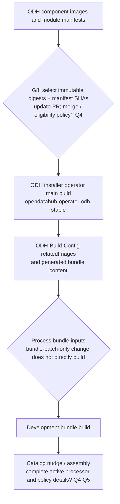
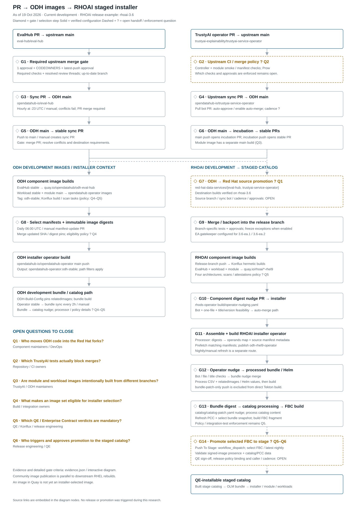

# From upstream PR to ODH images and a staged RHOAI installer

Research date: **19 October 2026**. Scope: **current ODH / next RHOAI development builds**, through a **QE-installable staged catalog**. The inspected RHOAI release-branch example is `rhoai-3.6`; EA branches have different freeze controls.

PRs in [eval-hub/eval-hub](https://github.com/eval-hub/eval-hub) and [trustyai-explainability/trustyai-service-operator](https://github.com/trustyai-explainability/trustyai-service-operator) pass through source synchronization, separate component builds, installer image selection, bundle generation and catalog promotion. An upstream merge or an image appearing in Quay does not establish that a staged installer contains it.

**Reading the diagrams:** diamonds represent gates or selection steps; dashed arrows and `?` identify unverified handoffs or enforcement. A workflow definition establishes configured behavior. Only the EvalHub upstream merge rules were verified as effective required checks; other test requirements remain qualified below. No builds, merges or promotions were triggered during this research.

- [Full SVG diagram](pr-to-installer/pr-to-installer.svg), with source links embedded in nodes.
- [Editable full Mermaid source](pr-to-installer/pr-to-installer.mmd).
- [Structured evidence](pr-to-installer/evidence.json), including commit-pinned source links, diagram nodes, gate descriptions and the observed EvalHub main branch rules.

## 1. Upstream PRs into ODH component images

The two component paths advance independently. Promotion PRs must merge before their destination branch advances. TrustyAI produces both a workload operator and a module operator.

```mermaid
flowchart TB
  subgraph eval["EvalHub source and ODH image"]
    EPR["eval-hub/eval-hub PR"] --> EG{"G1: required checks + review"}
    EG --> EM["Upstream main"]
    EM --> ES{"G3: hourly :23 UTC sync PR<br/>resolve conflicts + merge"}
    ES --> EODH["opendatahub-io/eval-hub main"]
    EODH --> EP{"G5: main to stable PR<br/>resolve conflicts + merge"}
    EP --> EST["stable push"]
    EST --> EB["Konflux build / scan tasks"]
    EB --> EI["quay.io/opendatahub/odh-eval-hub:odh-stable"]
    EM --> COMMUNITY["Parallel upstream CI output:<br/>quay.io/evalhub/evalhub"]
  end
  subgraph trustyai["TrustyAI source and ODH operator images"]
    TPR["trustyai-explainability/trustyai-service-operator PR"] --> TG{"G2: controller / module / Prow checks<br/>required merge policy? Q2"}
    TG --> TM["Upstream main"]
    TM --> TS{"G4: Pull bot sync PR<br/>auto-approve / enable auto-merge<br/>source config and cadence?"}
    TS --> TODH["opendatahub-io/trustyai-service-operator main"]
    TODH --> TP{"G6: main to incubation PR<br/>then incubation to stable PR; merge each"}
    TP --> TST["stable push"]
    TST --> TB["Konflux workload operator build"]
    TB --> TI["quay.io/opendatahub/trustyai-service-operator:odh-stable"]
    TODH --> MOD["Separate module build on main<br/>odh-trustyai-module-operator:odh-stable<br/>branch compatibility? Q3"]
  end
```

EvalHub's [stable pipeline][odh-eval-build] and the TrustyAI [workload stable pipeline][odh-workload-build] explicitly target `stable`. The TrustyAI [module pipeline][odh-module-build] targets `main`; even its [copy on stable][odh-module-stable] still names `main`. This is a concrete branch difference to confirm, rather than an assumption that all images build from the same branch.

The [central ODH build pipeline][odh-build-pipeline] defines scan tasks. Their presence alone does not establish which findings prevent image selection or merging. The parallel community image publisher is defined in [upstream CI][eval-ci]; RHOAI performs its own downstream builds.

## 2. ODH image selection and installer context

The [daily 06:00 UTC / manual manifest updater][manifest-update] opens a PR to update commit SHAs and resolve digests. Failed component fetches fail the workflow and mark the PR `do-not-merge`. The [installer configuration][manifest-pins] pins TrustyAI module manifests from ODH `main`, and maintains explicit related-image digests. [ODH Build Config][odh-digests] separately records selected image digests; atomic selection across these files has not been established.

The [installer build][odh-installer] publishes `opendatahub-operator:odh-stable` and nudges bundle inputs. [Bundle Sync CI][odh-bundle-sync] also generates bundle content from installer `stable` every two hours or on manual dispatch. The [bundle build trigger][odh-bundle] excludes bundle-patch-only pushes and nudges catalog inputs after building. This ODH installer context is included to explain how image availability differs from installer selection; the complete live ODH catalog processor/policy chain was not audited.

## 3. ODH source into RHOAI rebuilds and the staged installer

**The ODH-to-Red Hat component sync is intentionally an open question (Q1).** The destination release builds exist; the source branch, intermediate branches, automation and approvals were not established. The diagram does not imply that ODH container images are copied into RHOAI.

```mermaid
flowchart TB
  ODH["ODH component source branches"] -.-> SYNC{"G7: downstream source sync? Q1<br/>source / bot / schedule / approvals OPEN"}
  SYNC -.-> RELEASE["red-hat-data-services component release branches"]
  RELEASE --> MERGE{"G9: release PR / backport gate<br/>branch tests + approvals; freeze exceptions where enabled"}
  MERGE --> COMPONENTS["Separate Konflux hermetic RHEL builds<br/>EvalHub + workload operator + module operator<br/>quay.io/rhoai/*-rhel9"]
  COMPONENTS --> NUDGE{"G10: component digest nudge PR<br/>rhods-operator build/operator-nudging.yaml<br/>bot + single-file + title/version feasibility"}
  NUDGE --> ASSEMBLE["G11: Operator Processor<br/>digests / operands map + image source metadata<br/>prefetch manifests; commit processed content"]
  ASSEMBLE --> OPERATOR["RHOAI installer operator build<br/>quay.io/rhoai/odh-rhel9-operator"]
  OPERATOR --> BNUDGE{"G12: operator digest nudge PR<br/>RHOAI-Build-Config bundle/bundle-patch.yaml<br/>bot / file / title feasibility"}
  BNUDGE --> BPROCESS["Process CSV / relatedImages and Helm values<br/>commit generated bundle / chart content"]
  BPROCESS --> BUNDLE["Bundle build<br/>Helm chart builds are parallel outputs"]
  BUNDLE --> CNUDGE{"G13: catalog/catalog-patch.yaml nudge<br/>PCC refresh + bundle snapshot selection"}
  CNUDGE --> CPROCESS["Process catalog content; commit"]
  CPROCESS --> FBC["FBC fragment build<br/>live policy / EC / QE enforcement? Q5"]
  FBC -.-> STAGE{"G14: Push To Stage dispatch<br/>signed-image presence + catalog/PCC validation<br/>QE sign-off / caller / cadence? Q5-Q6"}
  STAGE -.-> RESULT["Build and monitor staged catalog<br/>QE installs via OLM"]
```

Both [EvalHub][rh-eval-build] and the TrustyAI [workload][rh-workload-build] and [module][rh-module-build] release PipelineRuns build downstream source and configure component digest nudges into the installer. The inspected pipelines cover x86_64, ppc64le, s390x and arm64. Matching release branches resolve the central pipeline from their release branch; scan definitions on central `main` are not proof of the deployed release policy.

The [operator nudge workflow][operator-nudge] checks the bot, file count and title/version pattern before invoking shared insta-merge logic. The [Operator Processor][operator-process] and its [implementation][processor-logic] combine nudged images with Build Config inputs, derive `git.url` / `git.commit` metadata and prefetch manifests. The resulting [installer build][rh-installer] nudges the bundle. A [nightly/manual refresh workflow][rh-nightly] also exists, but its external caller and cadence were not established.

The [bundle nudge workflow][rh-bundle-nudge] handles eligible bot PRs. [Bundle processing][rh-bundle-process] then generates content for the [bundle build][rh-bundle-build]. The bundle nudges catalog input; [FBC processing][rh-fbc-process] refreshes PCC and selects bundle snapshots before the [FBC build][rh-fbc-build]. **The direct bundle and FBC build triggers exclude patch-only pushes.** A nudge must pass through its processor and produce qualifying content before that build occurs.

[Push To Stage][stage] is a `workflow_dispatch` workflow that accepts a chosen FBC image or `LATEST_NIGHTLY`, checks signed-image presence, validates/regenerates PCC, patches the stage catalog and monitors catalog builds. A signature-presence check does not establish a full Enterprise Contract verdict. The inspected [integration-test scenario][ec-scenario] still names `rhoai-v2-17`, so it cannot prove the live `rhoai-v3-6` policy binding. Required QE sign-off remains Q5-Q6.

## Gate details

### G1 · Required upstream merge gate

Effective main rules require quality-checks, Gosec Security Scanner, gosec, dependency-review, CodeQL, docker-build-check; one review, code-owner review, last-push approval, stale-review dismissal and resolved threads. These are observed rules, not an audit of bypass actors. CI quality-checks runs formatting/vet, builds/tests including FVT, and documentation verification.

Evidence: [eval-hub/eval-hub · repository (main)][eval-rules], [eval-hub/eval-hub · .github/workflows/ci.yml (main)][eval-ci].

### G2 · Upstream CI / merge policy ? Q2

GitHub workflows configure controller and module tests. Prow always runs images, and e2e runs for matching paths or an explicit test command. The enforcement layer was not established; do not infer that every listed workflow blocks merging.

Evidence: [trustyai-explainability/trustyai-service-operator · .github/workflows/controller-tests.yaml (main)][operator-ci], [trustyai-explainability/trustyai-service-operator · .github/workflows/trustyai-module-e2e-test.yaml (main)][module-ci], [openshift/release · ci-operator/jobs/trustyai-explainability/trustyai-service-operator/trustyai-explainability-trustyai-service-operator-main-presubmits.yaml (main)][prow].

Open: Q2.

### G3 · Sync PR → ODH main

The hourly sync workflow uses a merge strategy, opens/updates a sync PR and fails on conflict. Effective main rules observed via GitHub require one approval. There is no workflow evidence that opening the sync PR automatically advances stable. Upstream CI also publishes quay.io/evalhub/evalhub independently.

Evidence: [opendatahub-io/eval-hub · .github/workflows/sync-upstream.yml (main)][eval-sync], [eval-hub/eval-hub · .github/workflows/ci.yml (main)][eval-ci].

### G4 · Upstream sync PR → ODH main

The workflow recognizes pull[bot], approves the sync PR and enables merge-commit auto-merge. This confirms the PR handling, but not the Pull app source configuration or sync schedule. Effective ODH main rules include one approval and CODEOWNERS/latest-push approval.

Evidence: [opendatahub-io/trustyai-service-operator · .github/workflows/auto-merge-upstream-sync.yaml (main)][operator-sync].

Open: Q1, Q2.

### G5 · ODH main → stable sync PR

Sync main to stable is a PR workflow with fail-on-conflict=true. It must merge before the stable push image build runs. Required checks on stable were not established.

Evidence: [opendatahub-io/eval-hub · .github/workflows/sync-main-to-stable.yml (main)][eval-stable].

### G6 · ODH main → incubation → stable PRs

Two workflows open promotion PRs. Creating these PRs is not evidence they have merged. The module operator build currently targets main, while the workload operator stable definition targets stable.

Evidence: [opendatahub-io/trustyai-service-operator · .github/workflows/sync-branch-incubation.yaml (main)][operator-incubation], [opendatahub-io/trustyai-service-operator · .github/workflows/sync-branch-stable.yaml (main)][operator-stable], [opendatahub-io/trustyai-service-operator · .tekton/odh-trustyai-module-operator-push.yaml (main)][odh-module-build].

Open: Q3.

### G7 · ODH → Red Hat source promotion ? Q1

The destination release PipelineRuns are verified. The ODH → Red Hat component synchronization mechanism and intermediate branch sequence have not been established. Do not treat this edge as an automatic promotion of ODH images: Red Hat performs a separate build from downstream source.

Evidence: [red-hat-data-services/eval-hub · .tekton/odh-eval-hub-v3-6-push.yaml (rhoai-3.6)][rh-eval-build], [red-hat-data-services/trustyai-service-operator · .tekton/odh-trustyai-service-operator-v3-6-push.yaml (rhoai-3.6)][rh-workload-build].

Open: Q1.

### G8 · Select manifests + immutable image digests

ODH Update Manifest SHAs runs make update-refs-shas and resolves image digests when updates are needed, opening a PR. Failed component fetches add do-not-merge and fail the workflow. manifests-config.yaml pins TrustyAI module manifests from ODH main and keeps explicit image digests. Build Config separately lists selected relatedImages. These configurations can lag independently; atomicity was not established.

Evidence: [opendatahub-io/opendatahub-operator · .github/workflows/update-manifest-shas.yml (main)][manifest-update], [opendatahub-io/opendatahub-operator · manifests-config.yaml (main)][manifest-pins], [opendatahub-io/ODH-Build-Config · bundle/bundle-patch.yaml (main)][odh-digests].

Open: Q3, Q4.

### G9 · Merge / backport into the release branch

Push builds run after code reaches the release branch. The inspected main gatekeeper definition calls shared post-codefreeze logic for two EA branches; confirm its deployed status, required label/approval policy, and branch coverage. Do not assume the EA gate applies to every development branch.

Evidence: [red-hat-data-services/eval-hub · .github/workflows/post-codefreeze-gatekeeper.yaml (main)][rh-freeze], [red-hat-data-services/eval-hub · .tekton/odh-eval-hub-v3-6-push.yaml (rhoai-3.6)][rh-eval-build], [red-hat-data-services/trustyai-service-operator · .tekton/odh-trustyai-service-operator-v3-6-push.yaml (rhoai-3.6)][rh-workload-build].

Open: Q1, Q2.

### G10 · Component digest nudge PR → installer

The installer insta-merge workflow restricts handling to konflux-internal-p02[bot], permitted title/version pattern and exactly the nudging file. It invokes shared insta-merge logic; this file alone does not establish additional CI or policy verdicts required before the nudge is emitted. The Operator Processor runs on an eligible bot push or manual dispatch.

Evidence: [red-hat-data-services/rhods-operator · .github/workflows/operator-insta-merge.yaml (main)][operator-nudge], [red-hat-data-services/rhods-operator · .github/workflows/operator-processor.yaml (main)][operator-process].

Open: Q4, Q5.

### G11 · Assemble + build RHOAI installer operator

The processor combines Build Config relatedImages with nudged digests, resolves image git.url/git.commit labels for manifest entries, and commits generated operands and prefetched content. A qualifying release-branch push builds the installer and nudges RHOAI Build Config bundle/bundle-patch.yaml. The nightly workflow is workflow_dispatch; its external cadence was not established.

Evidence: [red-hat-data-services/rhods-operator · .github/workflows/operator-processor.yaml (main)][operator-process], [red-hat-data-services/RHOAI-Konflux-Automation · utils/processors/operator-processor.py (main)][processor-logic], [red-hat-data-services/rhods-operator · .tekton/odh-operator-v3-6-push.yaml (rhoai-3.6)][rh-installer], [red-hat-data-services/rhods-operator · .github/workflows/trigger-nightly-operator-build.yaml (main)][rh-nightly].

Open: Q4, Q6.

### G12 · Operator nudge → processed bundle / Helm

RHOAI Build Config bundle-insta-merge validates bot and changed-file feasibility. Process Operator Bundle handles the input change and commits processed bundle/Helm content. The generated content, not merely a bundle-patch edit, triggers the bundle build. Helm builds are parallel outputs; this diagram follows OLM bundle/catalog to the staged installation endpoint.

Evidence: [red-hat-data-services/RHOAI-Build-Config · .github/workflows/bundle-insta-merge.yaml (rhoai-3.6)][rh-bundle-nudge], [red-hat-data-services/RHOAI-Build-Config · .github/workflows/process-operator-bundle.yaml (rhoai-3.6)][rh-bundle-process], [red-hat-data-services/RHOAI-Build-Config · .tekton/odh-operator-bundle-v3-6-push.yaml (rhoai-3.6)][rh-bundle-build].

Open: Q5.

### G13 · Bundle digest → catalog processing → FBC build

The bundle build nudges catalog/catalog-patch.yaml. Process FBC Fragment refreshes PCC, selects snapshot bundle images and commits catalog content. The direct FBC push trigger excludes catalog-patch-only changes. The inspected IntegrationTestScenario still names the 2.17 application and cannot establish the live 3.6 EC gate.

Evidence: [red-hat-data-services/RHOAI-Build-Config · .tekton/odh-operator-bundle-v3-6-push.yaml (rhoai-3.6)][rh-bundle-build], [red-hat-data-services/RHOAI-Build-Config · .github/workflows/process-fbc-fragment.yaml (rhoai-3.6)][rh-fbc-process], [red-hat-data-services/RHOAI-Build-Config · .tekton/rhoai-fbc-fragment-v3-6-push.yaml (rhoai-3.6)][rh-fbc-build], [red-hat-data-services/RHOAI-Build-Config · integration-tests/integration-test.yaml (rhoai-3.6)][ec-scenario].

Open: Q5.

### G14 · Promote selected FBC to stage ? Q5–Q6

Push To Stage accepts an FBC image (or LATEST_NIGHTLY), checks signed-image presence, validates/regenerates PCC, patches the stage catalog on Build Config main and monitors resulting catalog builds. A signature-presence check is not evidence of a full Enterprise Contract verdict. Required QE sign-off and the external trigger are not established.

Evidence: [red-hat-data-services/RHOAI-Build-Config · .github/workflows/push-to-stage.yaml (rhoai-3.6)][stage], [red-hat-data-services/RHOAI-Build-Config · integration-tests/integration-test.yaml (rhoai-3.6)][ec-scenario].

Open: Q5, Q6.

## Open questions

These are gaps in the evidence, not claims that controls are absent. Q1 stays open as requested.

### Q1. Who moves ODH code into the Red Hat forks?

Keep open: identify the exact source branch, target branch, bot/configuration, schedule, conflict owner, approvals, and backport rules for each component. Do stable → downstream main → rhoai-3.6 actually apply to both?

Suggested owner: **Component maintainers / DevOps**.

Evidence: [opendatahub-io/eval-hub · .github/workflows/sync-main-to-stable.yml (main)][eval-stable], [opendatahub-io/trustyai-service-operator · .github/workflows/sync-branch-stable.yaml (main)][operator-stable], [red-hat-data-services/eval-hub · .tekton/odh-eval-hub-v3-6-push.yaml (rhoai-3.6)][rh-eval-build], [red-hat-data-services/trustyai-service-operator · .tekton/odh-trustyai-service-operator-v3-6-push.yaml (rhoai-3.6)][rh-workload-build].

### Q2. Which TrustyAI tests actually block merges?

Controller, module smoke and Prow tests are configured. Prow e2e is path-triggered. The classic branch-protection endpoint was inaccessible and the branch-rules endpoint returned no rules for upstream TrustyAI; confirm Tide/branch protection, required contexts, approvals and override policy. ODH main rules show one approval; this does not establish stable/incubation requirements.

Suggested owner: **Repository / CI owners**.

Evidence: [trustyai-explainability/trustyai-service-operator · .github/workflows/controller-tests.yaml (main)][operator-ci], [trustyai-explainability/trustyai-service-operator · .github/workflows/trustyai-module-e2e-test.yaml (main)][module-ci], [openshift/release · ci-operator/jobs/trustyai-explainability/trustyai-service-operator/trustyai-explainability-trustyai-service-operator-main-presubmits.yaml (main)][prow], [opendatahub-io/trustyai-service-operator · .github/workflows/auto-merge-upstream-sync.yaml (main)][operator-sync].

### Q3. Are module and workload images intentionally built from different branches?

EvalHub and TrustyAI workload builds target stable. The TrustyAI module build targets main, including the copy on stable. ODH installer manifests pin TrustyAI main. Confirm that this split is intentional and that a compatible module + workload + EvalHub set is tested together.

Suggested owner: **TrustyAI / ODH maintainers**.

Evidence: [opendatahub-io/eval-hub · .tekton/eval-hub-push.yaml (stable)][odh-eval-build], [opendatahub-io/trustyai-service-operator · .tekton/odh-trustyai-service-operator-push.yaml (stable)][odh-workload-build], [opendatahub-io/trustyai-service-operator · .tekton/odh-trustyai-module-operator-push.yaml (main)][odh-module-build], [opendatahub-io/trustyai-service-operator · .tekton/odh-trustyai-module-operator-push.yaml (stable)][odh-module-stable], [opendatahub-io/opendatahub-operator · manifests-config.yaml (main)][manifest-pins].

### Q4. What makes an image set eligible for installer selection?

Digest pins and image-update PRs exist. Confirm which successful tests or policy verdicts gate a component digest nudge, who owns ODH Build Config updates, and what prevents mismatches between the selected image, module manifests, and provider ConfigMaps. The EvalHub ConfigMap sync workflow checks drift after main pushes and nightly; it does not itself promote changes.

Suggested owner: **Build / integration owners**.

Evidence: [opendatahub-io/opendatahub-operator · manifests-config.yaml (main)][manifest-pins], [opendatahub-io/ODH-Build-Config · bundle/bundle-patch.yaml (main)][odh-digests], [red-hat-data-services/rhods-operator · .github/workflows/operator-insta-merge.yaml (main)][operator-nudge], [eval-hub/eval-hub · .github/workflows/check-trustyai-service-operator-configmap-sync.yml (main)][config-sync].

### Q5. Which QE / Enterprise Contract verdicts are mandatory?

The source defines scan tasks and Early Gate testing, but that alone does not prove merge or stage enforcement. The inspected release integration-test YAML still names a 2.17 application. Confirm live 3.6 IntegrationTestScenarios, release policy, required BVT/e2e suites, exceptions and whether Early Gate is required.

Suggested owner: **QE / Konflux / release engineering**.

Evidence: [red-hat-data-services/konflux-central · pipelines/multi-arch-container-build.yaml (main)][rh-central], [red-hat-data-services/RHOAI-Build-Config · integration-tests/integration-test.yaml (rhoai-3.6)][ec-scenario], [red-hat-data-services/konflux-central · early-gate/docs/README.md (main)][early-gate].

### Q6. Who triggers and approves promotion to the staged catalog?

Push To Stage is workflow_dispatch and validates that a signed FBC image exists plus catalog/PCC data. Confirm the external caller or schedule, required QE sign-off, supported OCP versions and the exact catalog image/namespace QE installs. Next-development examples use rhoai-3.6; confirm when EA branches are the intended stream.

Suggested owner: **Release engineering / QE**.

Evidence: [red-hat-data-services/RHOAI-Build-Config · .github/workflows/push-to-stage.yaml (rhoai-3.6)][stage], [red-hat-data-services/eval-hub · .github/workflows/post-codefreeze-gatekeeper.yaml (main)][rh-freeze].

## How to prove that a particular PR reached stage

Record this chain for each component: upstream merge commit → ODH commit → downstream release commit → component image digest → merged installer nudge → installer digest → bundle digest → FBC digest → staged catalog digest. Compare the installed deployment image and module manifests with that selected set.

Provider adapter images are separate dependencies. The EvalHub API, init, sidecar and MCP binaries share the main service image. The [ConfigMap synchronization workflow][config-sync] checks drift on upstream main pushes, nightly and manually; it does not itself promote ConfigMap updates into the operator.

[Early Gate][early-gate] can check whether a set of unmerged PRs composes into an operator, bundle and catalog. Whether its result is mandatory belongs in Q5. Production release authorization is outside this diagram.

## Evidence boundaries and maintenance

Source-file links below are pinned to commits resolved during this investigation. The structured evidence retains the branch URLs for following current development. The GitHub branch-rules API is a live endpoint; its observed response is saved in `evidence.json` and may differ from today's response. Bypass actors, live Konflux resources, deployed IntegrationTestScenarios, successful workflow runs and QE verdicts were not audited.

Update the diagrams, gate descriptions and structured evidence together when a handoff is confirmed. In particular, replace dashed Q1 and stage edges only after the corresponding mechanism and mandatory controls are identified.

Full diagram snapshot

[eval-rules]: https://api.github.com/repos/eval-hub/eval-hub/rules/branches/main
[eval-ci]: https://github.com/eval-hub/eval-hub/blob/33605699cc4ec69796a9c570049663fc1011a8c0/.github/workflows/ci.yml
[operator-ci]: https://github.com/trustyai-explainability/trustyai-service-operator/blob/2852260f01a31ce92ed6e95b88bc3031be77f3e3/.github/workflows/controller-tests.yaml
[module-ci]: https://github.com/trustyai-explainability/trustyai-service-operator/blob/2852260f01a31ce92ed6e95b88bc3031be77f3e3/.github/workflows/trustyai-module-e2e-test.yaml
[prow]: https://github.com/openshift/release/blob/f3f2d1744d63f2a4f36424e4fa9a7a08fae8c8ef/ci-operator/jobs/trustyai-explainability/trustyai-service-operator/trustyai-explainability-trustyai-service-operator-main-presubmits.yaml
[eval-sync]: https://github.com/opendatahub-io/eval-hub/blob/ec8770ae040fa4e63f7585f572cc9f5e59dcde54/.github/workflows/sync-upstream.yml
[eval-stable]: https://github.com/opendatahub-io/eval-hub/blob/ec8770ae040fa4e63f7585f572cc9f5e59dcde54/.github/workflows/sync-main-to-stable.yml
[operator-sync]: https://github.com/opendatahub-io/trustyai-service-operator/blob/c517af62634a2c388df406994dede74f3ca95398/.github/workflows/auto-merge-upstream-sync.yaml
[operator-incubation]: https://github.com/opendatahub-io/trustyai-service-operator/blob/c517af62634a2c388df406994dede74f3ca95398/.github/workflows/sync-branch-incubation.yaml
[operator-stable]: https://github.com/opendatahub-io/trustyai-service-operator/blob/c517af62634a2c388df406994dede74f3ca95398/.github/workflows/sync-branch-stable.yaml
[odh-eval-build]: https://github.com/opendatahub-io/eval-hub/blob/cdb42724ee4ea84991a9ea80c0639cac345b57a9/.tekton/eval-hub-push.yaml
[odh-workload-build]: https://github.com/opendatahub-io/trustyai-service-operator/blob/309bf1a35ca9a75c72a5b66deae16b85514ef9f0/.tekton/odh-trustyai-service-operator-push.yaml
[odh-module-build]: https://github.com/opendatahub-io/trustyai-service-operator/blob/c517af62634a2c388df406994dede74f3ca95398/.tekton/odh-trustyai-module-operator-push.yaml
[odh-module-stable]: https://github.com/opendatahub-io/trustyai-service-operator/blob/309bf1a35ca9a75c72a5b66deae16b85514ef9f0/.tekton/odh-trustyai-module-operator-push.yaml
[odh-build-pipeline]: https://github.com/opendatahub-io/odh-konflux-central/blob/5c90e01e1826f4d539f1ef7e10fa2fec8034d5d5/pipeline/multi-arch-container-build.yaml
[manifest-update]: https://github.com/opendatahub-io/opendatahub-operator/blob/e1445db9585f25aed5f8bb54db13dc2f6ce6b45d/.github/workflows/update-manifest-shas.yml
[manifest-pins]: https://github.com/opendatahub-io/opendatahub-operator/blob/e1445db9585f25aed5f8bb54db13dc2f6ce6b45d/manifests-config.yaml
[odh-installer]: https://github.com/opendatahub-io/opendatahub-operator/blob/e1445db9585f25aed5f8bb54db13dc2f6ce6b45d/.tekton/odh-operator-ci-push.yaml
[odh-bundle]: https://github.com/opendatahub-io/ODH-Build-Config/blob/e9504048c67df9a2148b68a656407f38f34acc92/.tekton/odh-operator-bundle-ci-push.yaml
[odh-bundle-sync]: https://github.com/opendatahub-io/ODH-Build-Config/blob/e9504048c67df9a2148b68a656407f38f34acc92/.github/workflows/bundle-sync.yml
[odh-digests]: https://github.com/opendatahub-io/ODH-Build-Config/blob/e9504048c67df9a2148b68a656407f38f34acc92/bundle/bundle-patch.yaml
[rh-eval-build]: https://github.com/red-hat-data-services/eval-hub/blob/999680fab061e6d4dfb97e1d558e6cdbd4d7a40b/.tekton/odh-eval-hub-v3-6-push.yaml
[rh-workload-build]: https://github.com/red-hat-data-services/trustyai-service-operator/blob/718760309b309fb4c20b99cbee59bd21ada77796/.tekton/odh-trustyai-service-operator-v3-6-push.yaml
[rh-module-build]: https://github.com/red-hat-data-services/trustyai-service-operator/blob/718760309b309fb4c20b99cbee59bd21ada77796/.tekton/odh-trustyai-module-operator-v3-6-push.yaml
[rh-freeze]: https://github.com/red-hat-data-services/eval-hub/blob/9ac639a44ec89a47fea82f376344264eec8b8fce/.github/workflows/post-codefreeze-gatekeeper.yaml
[rh-central]: https://github.com/red-hat-data-services/konflux-central/blob/e416e32aab51af0668bcf0362effdf27ab0e16ee/pipelines/multi-arch-container-build.yaml
[operator-nudge]: https://github.com/red-hat-data-services/rhods-operator/blob/8e4548175331858f7ab3b883531d0c3509a15edd/.github/workflows/operator-insta-merge.yaml
[operator-process]: https://github.com/red-hat-data-services/rhods-operator/blob/8e4548175331858f7ab3b883531d0c3509a15edd/.github/workflows/operator-processor.yaml
[processor-logic]: https://github.com/red-hat-data-services/RHOAI-Konflux-Automation/blob/cd62bdee1311f45542d8608747e502de7f13315a/utils/processors/operator-processor.py
[rh-installer]: https://github.com/red-hat-data-services/rhods-operator/blob/1cc424c7522ff08e7d24cd97cbe187880f1ee0c5/.tekton/odh-operator-v3-6-push.yaml
[rh-nightly]: https://github.com/red-hat-data-services/rhods-operator/blob/8e4548175331858f7ab3b883531d0c3509a15edd/.github/workflows/trigger-nightly-operator-build.yaml
[rh-bundle-nudge]: https://github.com/red-hat-data-services/RHOAI-Build-Config/blob/3e9b401f59351d58d938699d90e6f1a0e2a3dac8/.github/workflows/bundle-insta-merge.yaml
[rh-bundle-process]: https://github.com/red-hat-data-services/RHOAI-Build-Config/blob/3e9b401f59351d58d938699d90e6f1a0e2a3dac8/.github/workflows/process-operator-bundle.yaml
[rh-bundle-build]: https://github.com/red-hat-data-services/RHOAI-Build-Config/blob/3e9b401f59351d58d938699d90e6f1a0e2a3dac8/.tekton/odh-operator-bundle-v3-6-push.yaml
[rh-fbc-process]: https://github.com/red-hat-data-services/RHOAI-Build-Config/blob/3e9b401f59351d58d938699d90e6f1a0e2a3dac8/.github/workflows/process-fbc-fragment.yaml
[rh-fbc-build]: https://github.com/red-hat-data-services/RHOAI-Build-Config/blob/3e9b401f59351d58d938699d90e6f1a0e2a3dac8/.tekton/rhoai-fbc-fragment-v3-6-push.yaml
[stage]: https://github.com/red-hat-data-services/RHOAI-Build-Config/blob/3e9b401f59351d58d938699d90e6f1a0e2a3dac8/.github/workflows/push-to-stage.yaml
[ec-scenario]: https://github.com/red-hat-data-services/RHOAI-Build-Config/blob/3e9b401f59351d58d938699d90e6f1a0e2a3dac8/integration-tests/integration-test.yaml
[early-gate]: https://github.com/red-hat-data-services/konflux-central/blob/e416e32aab51af0668bcf0362effdf27ab0e16ee/early-gate/docs/README.md
[config-sync]: https://github.com/eval-hub/eval-hub/blob/33605699cc4ec69796a9c570049663fc1011a8c0/.github/workflows/check-trustyai-service-operator-configmap-sync.yml
